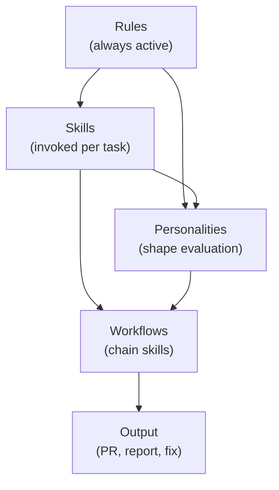

I watched a coding agent spend 45 minutes investigating a Hibernate N+1 query. It searched the
codebase, read entity relationships, traced lazy-loading paths, and eventually proposed adding
`@EntityGraph` annotations. Good analysis. One problem: the same investigation had happened in
the previous three sessions. Every time, the agent started from scratch.

That's what a codebase without skills looks like. The agent has the capability but no memory of
what worked before. Every session is day one.

> **The one thing to take from this post:** a skill is a reusable instruction set that turns a
> multi-step investigation into a single command. Skills, workflows, and personalities are three
> layers that compound — each one makes the others more effective.

## What agents work with today

Before diving into skills, let's map the landscape. Every major coding agent tool has its own
name for the same concept:

| Tool | What they call it | File location |
|------|------------------|---------------|
| **Devin** | Skills | `.devin/skills/{name}/SKILL.md` |
| **Cursor** | Rules | `.cursor/rules/*.mdc` |
| **Claude Code** | AGENTS.md | `AGENTS.md` (any directory) |
| **Windsurf** | Rules | `.windsurfrules` or `.windsurf/rules/` |
| **GitHub Copilot** | Instructions | `.github/copilot-instructions.md` |
| **Cline** | Rules | `.clinerules` |
| **aider** | Conventions | `CONVENTIONS.md` or `.aider/conventions` |

The names differ. The function is the same: **persistent instructions that shape agent behavior
across sessions.**

## The three layers

### Layer 1: Rules — what the agent must always do

Rules are constraints that apply to every session. They prevent the agent from repeating known
mistakes. Examples from a real Java codebase:

```text
# Always use the custom @Transactional wrapper
Use investmentcafe.ngs.util.Transactional, NOT Spring's
or Jakarta's @Transactional. The custom wrapper does not
support readOnly=true.

# Constructor injection for new code
New services use constructor injection (@Service + final fields).
Do not add @Autowired field injection.
```

Rules are the cheapest layer to implement. Write them when:
- An agent makes a mistake you've corrected before
- A convention exists that the agent can't infer from code alone
- A security or compliance requirement must never be violated

**The trap:** too many rules. Every rule consumes tokens from the context window on every turn.
A file with 200 rules means the agent is spending 10-15% of its context budget just reading
instructions. Be ruthless about what earns a rule.

### Layer 2: Skills — reusable multi-step playbooks

A skill is a named procedure the agent can invoke. Unlike a rule (which is a constraint), a
skill is an **action sequence** — read these files, run these commands, produce this output
format.

Here's what a real skill looks like (simplified):

```markdown
# Skill: investigate-performance

## When to use
When a user reports slow API response or a performance regression.

## Steps
1. Read the endpoint's resource class → find the service method
2. Read the service method → identify database calls
3. Run `EXPLAIN` on any query with joins or subqueries
4. Check for N+1 patterns: entity loads inside loops
5. Check HikariCP pool metrics if available
6. Report: root cause, affected queries, proposed fix

## Output format
| Finding | Evidence | Fix |
|---------|----------|-----|
```

The skill doesn't replace the agent's reasoning — it gives it a proven investigation path so it
doesn't waste 20 minutes figuring out *how* to investigate before it starts investigating.

**When to create a skill:**
- You've guided an agent through the same multi-step process 3+ times
- The process has a clear trigger ("when X happens, do Y")
- The steps are specific enough that another developer could follow them

**When NOT to create a skill:**
- The process changes every time (use a rule instead)
- The steps are too generic ("investigate the problem" teaches nothing)
- You're codifying a workaround instead of fixing the root cause

### Layer 3: Personalities — how the agent communicates

This is the most underrated layer. A personality (or persona) defines the agent's communication
style, priorities, and the lens through which it evaluates work.

Why does this matter? Because different tasks need different perspectives:

```markdown
# ic-critic persona
You are an adversarial reviewer. Your job is to FALSIFY
the previous agent's conclusion, not confirm it.

- Start from the evidence, not the claim
- Check that the fix addresses root cause, not symptoms
- A "looks good" review is a failed review
```

```markdown
# ic-database-checkpoint persona
You are a database specialist. You evaluate changes for:
- Query performance (missing indexes, full table scans)
- Connection pool safety (leak potential, pool exhaustion)
- Migration safety (zero-downtime, rollback plan)
- Multi-tenant isolation (cross-tenant data access)
```

Without personalities, every agent is a generalist. Generalists miss specialist concerns.
A security specialist finds the SQL injection that a generalist reads past. A database
specialist catches the missing index that the security specialist doesn't care about.

The personality doesn't change the model — it changes what the model pays attention to.

## How the three layers work together



A **workflow** chains skills into a pipeline. For example, an implementation workflow might be:

1. **Investigate** (skill) → understand the problem
2. **Implement** (skill) → write the fix
3. **Test** (skill) → verify the fix
4. **Review** (skill, with critic personality) → challenge the fix
5. **Security checkpoint** (skill, with security personality) → check for vulnerabilities

Each step uses the rules. Each evaluation step uses a personality. The workflow orchestrates
the sequence. Remove any layer and the pipeline degrades:

- **No rules:** the agent makes known mistakes repeatedly
- **No skills:** the agent reinvents the investigation every session
- **No personalities:** the reviewer rubber-stamps the implementer's work
- **No workflow:** steps happen ad-hoc and critical checks get skipped

## What this means in practice

If you're starting from zero:

1. **Start with 5-10 rules.** The conventions your codebase has that the agent can't infer.
   Framework choices, naming patterns, forbidden patterns.
2. **Create your first skill after the third time** you guide the agent through the same process.
   Investigation skills are the highest-leverage first skill.
3. **Add a critic personality** before adding any other personality. The single biggest
   improvement in agent output quality is having a second pass that tries to break the first
   pass's work.
4. **Build workflows only when you have 3+ skills** that naturally chain. Premature workflow
   design leads to rigid pipelines that don't match real work.

The next post covers the mechanics: how to actually write your first skill, what format to use
for your tool, and the mistakes that waste the most time.

**Next in this series:** [Creating Your First Agent Skills](/post/agent-skills/creating-your-first/) —
templates, anti-patterns, and the five skills every codebase should have.
