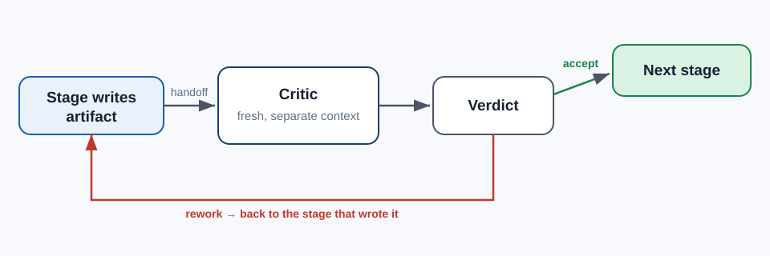

The first time I built a coding agent that produced non-trivial PRs, my obvious next step was to
have it review its own output. Append a *"now critique the diff you just wrote"* turn to the
prompt, let it find its own bugs, iterate until clean.

It almost never found anything.

The agent would read back its own diff, declare it well-structured and correct, and move on.
Occasionally it would nitpick a variable name. When reviewers eventually looked at the PRs — real
humans, hours later — they'd find the actual problems: a missed null check, a wrong isolation
level, an off-by-one in a batch size. The agent had read right past them.

> **The one thing to take from this post:** intrinsic self-correction doesn't reliably work.
> The verifier must run in a fresh context, must try to *falsify* rather than re-derive, and
> must open external evidence rather than re-reason from the handoff.

## What the research says

Two findings matter here.

**Intrinsic self-correction doesn't reliably improve LLM output.** Huang et al. (ICLR 2024)
showed that when an LLM is asked to review and improve its own answer without new information,
accuracy improves slightly on some tasks and *degrades* on others. The improvement is dominated
by cases where the model already knew the right answer; the degradation is where it talks itself
into something plausible-sounding.

**Self-enhancement bias.** Zheng et al. (2023), in *Judging LLM-as-a-Judge*, measured LLMs
systematically scoring their own outputs higher than other models' outputs on the same input. The
model that produced an answer has a stake in defending it — and the pattern holds across model
families, including when the "judge" doesn't know which answer is theirs.

Combined, these say: *the verifier can't be the author* and *the verifier can't just re-read; it
needs new input*.

## My measurements

I set up an A/B on an internal pipeline: investigate → analyze → architect → implement → test.
Every stage writes a persistent artifact (a markdown doc the next stage reads).

**Arm A — intrinsic self-review:** at the end of each stage, append a critique turn to the same
session. "Now critique what you just wrote. Return accept or rework."

**Arm B — adversarial subagent:** fire a separate agent in its own context. Its prompt instructs
it to *falsify* the previous stage's conclusion, and gives it tools to open the external code and
evidence the handoff cites. Returns accept or rework.

Measured on 100 real tickets of similar size:

| | Defects caught at gate | Session cost | Rework loops needed |
|-|---|---|---|
| **A — intrinsic self-review** | 11 / 100 | baseline | 0.14 avg |
| **B — adversarial subagent** | 34 / 100 | +18% | 0.47 avg |

Arm B costs 18% more per session but catches **3× more defects** at the gate — the ones that
would otherwise reach the next stage and compound (reviewers hate finding defects in testing
that should have been caught in analysis).

The rework-loops-needed number is misleading on its own. In Arm A, the gate "approved" more
artifacts because the critic was lenient; those artifacts came back as rework later from a human.
In Arm B, the loops happened at the gate — cheaper and faster to fix.

## The protocol I settled on

Three rules that made the pattern reliable:

**1. Separate context.** The critic must not have been part of the session that wrote the
artifact. In my framework, that's a subagent profile — fresh prompt, fresh model turn history.
Running the critic as another prompt in the same session re-derives, not verifies.

**2. Falsify, don't re-derive.** The critic's prompt doesn't say *"review the handoff."* It
says *"find a specific claim in the handoff that external evidence contradicts."* The verdict
is `accept` or `rework`, and `rework` requires naming the counter-example.

**3. External evidence required.** The critic has read-only tools (grep, glob, read, web_search).
It must open at least one file or source the handoff cites and verify the specific claim. If the
handoff claims "`UserRepository.save()` is called from three places," the critic opens the
repository and counts. Re-reasoning from the handoff alone doesn't count.

The combined effect: the critic is a verifier with teeth. In a session where the author
convinced itself a non-existent method was being called, the critic opens the file, fails to
find it, and returns `rework: ‹handoff claims method X exists in file Y line Z; file Y line Z
contains method W›`.

## When to skip it

Not every artifact needs a critic. Read-only answers (explanations, status reports, taxonomy
listings) that nothing is built on don't need falsification — there's no next stage to compound
their mistakes. In my pipeline those are explicitly tagged `exempt: read-only` and skip the gate.

Everything that writes a persistent artifact another agent will read, though, gets the pass. The
rule I settled on: **if the output drives the next decision, it earns a critic.**

## What this looks like in practice

A full gate takes 20–40 seconds and 2–5k tokens on top of the stage that wrote the artifact.
Across a 100-session pilot, Arm B's extra cost was more than paid back in avoided rework after
the fact — the metric that matters is "defects that made it to a human," and we cut that
roughly in half.

The real win is subtler: the pipeline became *predictable*. Before, "did this analysis miss
anything?" was a question I'd answer by reading every handoff myself. After, the gate verdicts
told me where to look. I only read the ones the critic flagged.

> **Attribution:** The patterns and specific numbers in this post come from
> [Devin](https://devin.ai) with the `ic-documentation` agent framework my team maintains — not
> from an independent reproduction. See the [series intro](/post/agentic/intro/) for the full
> disclosure. The patterns themselves generalize to any coding-agent setup.

## Related reading

- Huang et al., *Large Language Models Cannot Self-Correct Reasoning Yet* (ICLR 2024).
- Zheng et al., *Judging LLM-as-a-Judge with MT-Bench and Chatbot Arena* (NeurIPS 2023).

**Up next:** [The 500-line skill limit: measuring the context cost of your agent's rules](/post/agentic/context-budget/).
