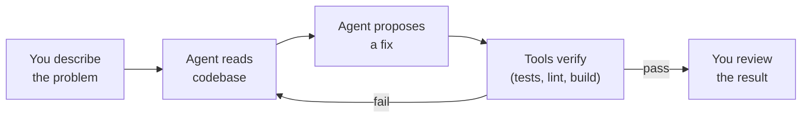

Last year I asked a coding agent to fix a null-pointer exception in a Spring Boot service. It read
the stack trace, found the file, traced the call chain, wrote a null check, added a test, and
opened a PR. The whole thing took four minutes. I would have spent twenty.

That's when I stopped treating AI as a better autocomplete and started treating it as a junior
developer who works at machine speed but needs clear instructions.

> **The one thing to take from this post:** agentic development is not "AI writes code for me."
> It's a loop — you describe the problem, the agent proposes a solution, tools verify it, and
> you decide. Understanding that loop is the only prerequisite.

## What "agentic" actually means

An **agent** is an AI model that can use tools. Not just generate text — actually *do things*:
read files, run commands, search codebases, edit code, execute tests. The model decides which
tool to call, interprets the result, and decides what to do next.

That's the difference from autocomplete (Copilot-style inline suggestions) and chat (ask a
question, get an answer). Both are useful. Neither can fix a bug across three files, run the
tests, and iterate until they pass.



The loop is the key. An agent that generates code without running it is just a chatbot with
extra steps. An agent that runs tests, reads the failure, and tries again is doing something
qualitatively different.

## The five concepts you need

### 1. Context window = the agent's working memory

Every AI model has a **context window** — the maximum amount of text it can hold in memory at
once. Current models range from 128K to 200K tokens (roughly 100K–150K words). That sounds
like a lot, but a 4,000-file Java codebase is millions of tokens. The agent can never see
everything at once.

This matters because:
- The agent must **search** for relevant code rather than "knowing" it
- Long system prompts, rules, and conversation history eat into the budget
- A session that runs too long loses early context

**Practical implication:** if you dump your entire project into the prompt, the agent drowns.
Instead, point it at the specific file or error, and let it search outward as needed.

### 2. Tools = what the agent can actually do

A coding agent typically has access to:

| Tool | What it does |
|------|-------------|
| **Read file** | Open and read any file in the project |
| **Edit file** | Make targeted changes to specific lines |
| **Search** | Grep, glob, or semantic search across the codebase |
| **Shell** | Run commands — build, test, lint, git |
| **Browser** | Preview web apps, read documentation |

The agent chooses which tools to call based on the task. When you say "fix the failing test in
`UserServiceTest`", the agent might: (1) read the test file, (2) read the service it tests,
(3) search for related classes, (4) edit the service, (5) run the test, (6) read the failure
output, (7) edit again, (8) run again until it passes.

Each tool call costs tokens and time. An agent that makes 50 unnecessary file reads is burning
your budget. This is why experienced users learn to give focused instructions.

### 3. Prompts and rules = your instructions to the agent

You control agent behavior through:

- **The task prompt** — what you type: "fix the NPE in `ContactService.findByEmail`"
- **System rules** — persistent instructions loaded every session: "always use constructor
  injection", "never modify security config without asking"
- **Project rules** — conventions specific to this codebase: "use `investmentcafe.ngs.util.Transactional`,
  not Spring's `@Transactional`"

Good rules prevent the agent from making the same mistake twice. Bad rules (vague, contradictory,
or too many) confuse it. The sweet spot is a small set of specific, actionable constraints.

```text
# Good rule
Use JUnit 5 (@Test from org.junit.jupiter.api.Test).
Use @ExtendWith instead of @RunWith for extensions.

# Bad rule
Write good tests that follow best practices
and ensure comprehensive coverage.
```

The good rule is specific and falsifiable — you can check whether the agent followed it. The
bad rule means nothing actionable.

### 4. The feedback loop = how agents learn within a session

Agents don't learn between sessions (they start fresh every time), but they learn *within* a
session through tool results. When a test fails, the agent reads the error and adjusts. When a
build breaks, it reads the log and fixes the import.

This is the feedback loop, and it's the most powerful part of agentic development:

1. Agent writes code
2. Agent runs tests
3. Tests fail with a specific error
4. Agent reads the error, understands it, adjusts the code
5. Agent runs tests again
6. Tests pass

The loop works best when feedback is fast and specific. A test that fails with
`NullPointerException at line 47` gives the agent everything it needs. A test that fails with
`Build failed` gives it nothing.

**Practical implication:** invest in good test infrastructure. Fast tests with clear error
messages are force multipliers for coding agents.

### 5. Verification = you're still the senior developer

The agent proposes. You decide. This isn't a philosophical position — it's practical:

- Agents hallucinate. They'll confidently import a library that doesn't exist in your project.
- Agents miss context. They'll fix the immediate symptom without understanding the architectural
  constraint that caused it.
- Agents over-fix. Ask them to fix one bug and they'll "improve" three other things along the way.

**Review every diff.** Read what changed, why it changed, and what else it could affect. The
agent saved you the time of writing the code; spend some of that saved time on a careful review.

In my experience, agents produce correct code about 70-80% of the time on well-scoped tasks.
That remaining 20-30% is where your expertise matters most.

## Your first session: a practical checklist

Ready to try? Here's what makes a good first task:

- **A failing test you already understand.** You know what's wrong; you want to see if the
  agent can find and fix it.
- **A small, well-scoped bug.** One file, one function, clear expected behavior.
- **A code refactor with existing test coverage.** Extract a method, rename a variable across
  files, convert a pattern. Tests tell the agent when it's done.

And what to avoid for your first session:

- **Multi-repo changes.** Start in one repository.
- **Vague requirements.** "Make the API faster" gives the agent nothing to verify against.
- **Security-sensitive code.** Until you're confident in your review process.

## What to expect (honestly)

The first few sessions will feel slower than coding it yourself. You'll spend time learning how
to phrase tasks, what level of detail the agent needs, and when to intervene versus letting it
iterate.

After about a week, you'll develop an intuition for what agents handle well (mechanical changes,
boilerplate, well-defined bugs) versus what they struggle with (architectural decisions, novel
algorithms, cross-cutting concerns with no tests).

After a month, you'll wonder how you ever did bulk refactors by hand.

## Where to go deeper

If this post made sense and you want the measured, opinionated take on making agents work on a
real legacy codebase:

- [Agentic Development: What Actually Works in Legacy Java](/post/agentic/intro/) — the 10-part
  series covering critic patterns, context budgets, eval harnesses, and the patterns that
  actually moved the needle over six months of production use.
- [Why Your Coding Agent Needs a Different Critic](/post/agentic/different-critic/) — the first
  deep dive: why self-review doesn't work and what to do instead.

The series assumes you've run at least a few agent sessions. This post is the prerequisite it
was missing.
