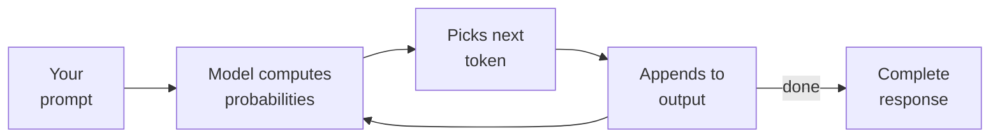

A colleague asked me last month: "So ChatGPT just has a massive database of code and looks up
the answer?" No. That's a search engine. An LLM is something weirder and more interesting — and
understanding the difference explains half the strange behavior you've seen when using AI tools.

This post is the mental model I wish someone had given me before I started using AI in my
daily work. No math, no PhD prerequisites — just enough to understand why the tool works when
it works and breaks when it breaks.

> **The one thing to take from this post:** an LLM is a pattern completion engine, not a
> knowledge database. It predicts the next word based on patterns it learned during training.
> This single fact explains both its strengths and its failures.

## What an LLM actually is

### The 5-year-old version

Imagine you've read every book, every Stack Overflow answer, every GitHub repo, and every blog
post ever written. Not memorized — *absorbed*. You developed an intuition for how sentences flow,
how code works, how arguments are structured. When someone starts a sentence, you can predict
how it probably ends.

That's an LLM. It's a prediction engine trained on a massive amount of text. Given a sequence of
words (or code tokens), it predicts what comes next. That's it. Everything else — conversation,
code generation, reasoning — emerges from this one capability applied at scale.

### The developer version

An LLM is a neural network with billions of parameters (weights). During training, it processed
trillions of tokens of text and code. The training process adjusted those weights to minimize
prediction error — "given these tokens, what token comes next?"

The key numbers for current models (2026):

| Model | Parameters | Training data | Context window |
|-------|-----------|---------------|----------------|
| GPT-4o | ~200B (estimated) | Trillions of tokens | 128K tokens |
| Claude Opus 4 | ~250B (estimated) | Trillions of tokens | 200K tokens |
| Llama 3.1 405B | 405B | 15T+ tokens | 128K tokens |
| Gemini 2.5 Pro | ~500B (estimated) | Trillions of tokens | 1M tokens |

The parameter count determines the model's capacity to store patterns. The training data
determines which patterns it learned. The context window determines how much it can consider
at once.

### What "tokens" are

A token is roughly 3/4 of a word in English, or about 3-4 characters. For code, tokenization is
less predictable — common identifiers like `public` or `return` are single tokens, but unusual
variable names get split into pieces.

```text
"public void processOrder()" → 6 tokens
"xQ7zCustomImpl" → 5-6 tokens (unusual names cost more)
```

This matters because your context window is measured in tokens. A 200K token window fits roughly
150K words of English or about 50K lines of code. Your 4,000-file Java project? Way more than
that.

## How modern LLMs work

### Training (the expensive part)

Training happens once and costs millions of dollars. The model reads text, predicts the next
token, checks if it was right, and adjusts its weights. Repeat this trillions of times.

What the model learns during training:
- **Syntax patterns**: how Java methods are structured, how SQL queries are formed
- **Semantic relationships**: `HashMap` and `ConcurrentHashMap` serve similar purposes but differ
  in thread safety
- **Reasoning patterns**: if A implies B and B implies C, then A implies C
- **Code patterns**: this type of bug usually has this type of fix

What the model does NOT learn:
- **Your codebase** (it hasn't seen it)
- **Today's news** (training data has a cutoff)
- **Facts as facts** (it learned patterns, not a database)

### Inference (the part you use)

When you type a prompt, the model processes it token by token and generates a response, one
token at a time. Each new token is chosen based on the probability distribution the model
computes over all possible next tokens.

This is autoregressive generation — each token depends on everything before it. The model
doesn't plan ahead. It doesn't outline the answer and then fill it in. It generates left to
right, one token at a time, and each choice constrains what comes next.



This explains a lot of LLM behavior:
- **Why they commit to wrong answers**: once the first few tokens of an answer are generated,
  the model is statistically likely to continue in that direction
- **Why they're bad at counting**: "count the r's in strawberry" requires tracking state across
  tokens, which the architecture doesn't naturally support
- **Why they're good at pattern matching**: recognizing that a code pattern looks like a known
  bug is exactly what the architecture is built for

### The attention mechanism (why context matters)

The transformer architecture (which powers all modern LLMs) uses **attention** — the ability to
focus on relevant parts of the input when generating each token. When the model writes
`return userRepository.`, it attends to the earlier parts of the prompt where the repository
methods are defined.

This is why context window size matters. A larger window means the model can attend to more
information at once. But attention has a cost — it scales quadratically with sequence length
(though modern architectures use optimizations to reduce this).

**For developers, this means:**
- Relevant information should be close to where you ask the question
- Very long contexts dilute attention — the model may miss details buried in the middle
- System prompts (always at the top) get strong attention; information in the middle of a long
  conversation gets less

## When LLMs perform best

### Pattern recognition and transformation

LLMs excel at tasks that involve recognizing a pattern and applying it. This covers a
surprisingly large fraction of daily development work:

- **Bug patterns**: "This NPE happens because X is null when Y is called" — the model has seen
  thousands of similar NPE patterns
- **Boilerplate generation**: CRUD endpoints, DTO conversions, test scaffolding — patterns the
  model has seen millions of times
- **Code translation**: "Convert this Java code to Kotlin" — the model understands both
  grammars and the semantic mapping between them
- **Refactoring**: Extract method, rename across files, convert to builder pattern — mechanical
  transformations with clear rules

### Explaining existing code

LLMs are remarkably good at reading code and explaining what it does. The model has seen so
many examples of code + documentation that it can generate accurate explanations of most code
patterns.

### Summarization and synthesis

Given 10 pages of documentation, an LLM can produce a useful 1-paragraph summary. This is
pattern completion at its best — the model knows how summaries are structured and can identify
the important parts.

### Working within well-defined constraints

When you give the model clear constraints — "use JUnit 4, not JUnit 5", "follow this naming
convention", "produce output in this JSON format" — it follows them reliably. Constraints
narrow the prediction space, making the model more accurate.

## When LLMs perform badly

### Novel reasoning

If the task requires genuine novel reasoning — solving a problem nobody has solved before in a
way that isn't a combination of known patterns — the model struggles. It can combine patterns
in creative ways, but it can't invent genuinely new algorithms.

### Counting and precise math

"How many parameters does this function have?" seems trivial, but requires the model to count
tokens, which doesn't map well to the prediction architecture. Simple arithmetic works; complex
math is unreliable.

### Consistent state tracking

"Keep track of which variables are in scope" or "remember that we changed the return type three
messages ago" — the model doesn't have a scratchpad. It uses attention to look back at the
conversation, but this is fuzzy, not precise.

### Saying "I don't know"

LLMs are trained to generate plausible text. If you ask about something the model hasn't seen
enough of in training, it will generate a plausible-sounding answer rather than admitting
uncertainty. This is **hallucination** — the model producing confident nonsense.

In code, this manifests as:
- Inventing API methods that don't exist
- Referencing libraries with made-up function signatures
- Generating code that looks correct but has subtle logic errors

### Long-range consistency

In a long conversation (or a large codebase), the model may contradict earlier decisions. It's
not working from a plan — it's predicting the next token, and the prediction is influenced by
everything in the context window, with diminishing attention to older parts.

## The practical takeaways

Understanding these strengths and limitations directly improves how you use LLMs in development:

| Do this | Because |
|---------|---------|
| Give specific constraints | Narrows the prediction space, more accurate output |
| Provide relevant context close to your question | Attention is strongest on nearby tokens |
| Verify generated code — always | Hallucination is structural, not a bug to be fixed |
| Use for pattern-based tasks | This is what the architecture is literally built for |
| Don't trust precise counts or math | The architecture doesn't naturally support counting |
| Break long tasks into steps | Each step gets fresh, focused attention |
| Check library imports and API calls | Models hallucinate function signatures frequently |

## What makes an LLM "good at code"

Not all LLMs are equal for development work. The differences come from:

1. **Training data mix**: models trained on more code (especially the right languages) perform
   better on coding tasks
2. **Fine-tuning**: additional training specifically on code-related tasks (completing functions,
   fixing bugs, writing tests)
3. **RLHF (Reinforcement Learning from Human Feedback)**: human evaluators rating code quality,
   teaching the model what "good code" looks like
4. **Context window**: larger windows = more of your codebase fits in memory
5. **Tool use training**: models specifically trained to call tools (run tests, read files)
   perform better as agents than models that just generate text

This is why the same model can be great at generating Python but mediocre at COBOL — it depends
on what was in the training data.

## Where to go from here

Now that you have a mental model for how LLMs work, the next step is understanding how they
become **agents** — LLMs that can use tools, iterate on feedback, and work autonomously on
real code:

- [Getting Started with Agentic Development](/post/agentic/getting-started/) — the five concepts
  you need before your first coding agent session
- [Agent Skills, Workflows, and Personalities](/post/agent-skills/what-are-skills/) — how to
  give agents reusable instructions

The LLM is the engine. The agent framework is the car. Understanding both helps you drive.
