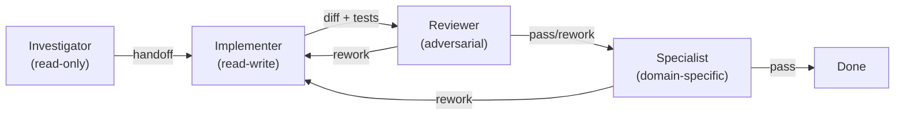

My first agent pipeline was one agent doing everything: investigate, implement, test, review.
It worked about 60% of the time. The failures were always the same shape: the agent would make
a mistake early, fail to catch it during review (because it was reviewing its own work), and
produce a PR with a subtle bug that passed its own tests but broke in integration.

Splitting that pipeline into four agents — investigator, implementer, reviewer, specialist
checkpoint — took the completion rate from 60% to 85%. The cost per session went up 30%.
The rework rate went down 60%. Net result: significantly cheaper per completed task.

> **The one thing to take from this post:** multi-agent isn't about speed. It's about
> preventing the single-agent failure mode where the same context that produced a mistake
> also reviews it and misses it.

## Why single-agent breaks down

A single agent running through investigate → implement → test → review has one fundamental
problem: **context contamination**. By the time it reaches the review step, its context window
is full of the reasoning that produced the implementation. It's reviewing with the same mental
model that wrote the code.

This is the self-correction problem documented in research (Huang et al., ICLR 2024) — LLMs
re-reading their own output re-derive the same conclusion. The review step becomes a
rubber stamp.

Multi-agent solves this by giving the reviewer a fresh context. It sees the diff, the
requirements, and the test results — but not the 30 minutes of investigation and false starts
that preceded them.

## The four-agent pipeline



### Agent 1: Investigator (read-only)

**Role:** Understand the problem. Do not fix it.

**Tools:** read, grep, search — no write access.

**Output:** A structured handoff document:

```markdown
## Investigation: {task}

### Root cause
{one paragraph — what's wrong and why}

### Affected files
{list of files that need to change}

### Proposed approach
{how to fix it — strategy, not code}

### Risks
{what could go wrong with this approach}
```

**Why separate?** Without a boundary, agents start fixing things during investigation. They
read a file, see a problem, and edit it — before understanding the full scope. Separating
investigation from implementation forces a complete understanding before any changes.

### Agent 2: Implementer (read-write)

**Role:** Execute the fix described in the handoff. Write tests.

**Input:** The investigator's handoff document.

**Tools:** read, write, edit, exec (full access).

**Output:** Code changes + passing tests.

**Why separate?** The implementer receives a scoped problem and a proposed approach. It doesn't
need to spend tokens investigating — it goes straight to implementation. This focused scope
reduces wandering and hallucination.

### Agent 3: Reviewer (adversarial, fresh context)

**Role:** Try to break the implementation. Find what's wrong.

**Input:** The diff, the test results, and the original task description. NOT the investigation
or implementation reasoning.

**Personality:**

```markdown
You are an adversarial code reviewer. Your job is to find problems,
not confirm correctness.

For each finding:
1. Quote the exact code (file:line)
2. State what's wrong
3. State the consequence if not fixed
4. Suggest a specific fix

A review with zero findings is suspicious — look harder.
```

**Why separate?** This is the critical separation. The reviewer has never seen the reasoning
that produced the code. It can't re-derive the same conclusion because it doesn't have the
same context. It evaluates the output on its merits, not the intention behind it.

### Agent 4: Specialist checkpoint (domain-specific)

**Role:** Check the change through a domain-specific lens.

**Input:** The diff + the reviewer's verdict.

**Personality:** One of several specialists, activated based on what the change touches:

| Specialist | Triggers on | Checks for |
|-----------|------------|------------|
| **Database** | Entity changes, migrations, SQL | Missing indexes, N+1, deadlocks, rollback |
| **Security** | Auth, encryption, input handling | Injection, SSRF, credential exposure |
| **Performance** | Hot paths, batch ops, queries | Regression, memory, connection pools |
| **DevOps** | CI/CD, Docker, deployment | Build breaks, env config, rollback plan |

**Why separate?** A generalist reviewer misses specialist concerns. The database specialist
catches the missing index that the generalist reads past. You don't need all four on every
change — only the ones relevant to what was modified.

## Handoff formats

The handoff between agents is the most important design decision. Bad handoffs lose information
and force the next agent to re-investigate.

### The structured handoff

```markdown
## Handoff: {agent} → {next agent}

### Task
{original task description}

### What was done
{summary of actions taken}

### Key decisions
{choices made and why}

### Output
{diff, test results, or analysis}

### Open questions
{anything the next agent should verify}
```

### The common mistake: dump the whole context

Some multi-agent setups pass the entire conversation from Agent 1 to Agent 2. This defeats
the purpose — Agent 2 now has Agent 1's full reasoning context, which is exactly what we're
trying to avoid for the reviewer.

**Rule:** handoffs should contain outputs and decisions, not reasoning traces. The reviewer
should see what was changed, not why the agent considered and rejected three other approaches.

## When multi-agent beats single-agent

Multi-agent isn't always better. It adds orchestration complexity and token cost.

### Use multi-agent when:

- **The change affects 3+ files** — enough scope that self-review misses things
- **The change touches security, auth, or data** — specialist review catches what generalists miss
- **The task has a rework rate above 30%** — the review step will save more than it costs
- **The codebase is large** — a fresh-context reviewer catches assumptions the implementer
  made about code it didn't read

### Use single-agent when:

- **The change is mechanical** — rename, import fix, boilerplate addition
- **Strong test coverage exists** — tests are the reviewer, the agent just needs to pass them
- **The task is small and well-defined** — one file, one function, clear expected behavior
- **Speed matters more than correctness** — prototyping, exploration, throwaway code

## Orchestration patterns

### Sequential (simple pipeline)

```text
investigate → implement → review → specialist → done
```

Each agent runs after the previous one completes. Simple to implement. Works for most tasks.

### Parallel specialists

```text
                    ┌─→ security checkpoint ─┐
implement → review ─┤                        ├→ merge verdicts → done
                    └─→ database checkpoint ──┘
```

Multiple specialists run simultaneously on the same diff. Reduces wall time. Requires
a merge step to consolidate findings.

### Iterative (with rework loops)

```text
implement ←──────────────────┐
    ↓                        │
  review                     │
    ↓                        │
  pass? ── no ── rework ─────┘
    ↓
  done
```

The reviewer sends findings back to the implementer, which fixes and resubmits. Cap the
iterations (2-3 max) to prevent infinite loops.

## The cost trade-off

Multi-agent costs more tokens per task:

| Setup | Tokens per task | Completion rate | Cost per completed task |
|-------|----------------|-----------------|------------------------|
| Single agent | ~50K | ~60% | ~$0.50 |
| Four agents | ~80K | ~85% | ~$0.47 |

The per-task token cost is higher, but the per-*completed*-task cost is lower because fewer
tasks fail and need to be redone manually.

The break-even point is roughly: if your single-agent completion rate is below 70%, multi-agent
is cheaper per completed task despite higher per-session cost.

**Related:** [Why Your Coding Agent Needs a Different Critic](/post/agentic/different-critic/)
for the research behind context separation, and
[The Specialist Checkpoint Pattern](/post/agentic/specialist-checkpoints/) for when to add
domain-specific reviewers.
