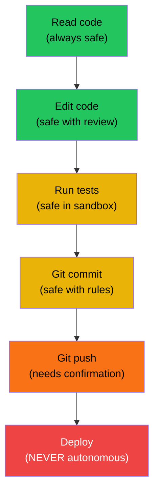

An agent expanded a PAT token into a shell command argument. The token appeared in the process
list, the shell history, and the CI log. It was a valid production credential. We caught it in
review, rotated the token, and added a rule that same day. But "caught it in review" is not a
security strategy.

Coding agents are powerful tools with real access to your systems. Treating them like a trusted
developer with no boundaries is how credentials leak, databases get wiped, and force-pushes
destroy branch history.

> **The one thing to take from this post:** an agent should have the minimum access needed for
> the current task. Every privilege you grant is a privilege that can be misused — not
> maliciously, but through the same pattern-matching that makes agents useful.

## The trust model

Think of an agent as a contractor who is brilliant at their specialty but has no judgment about
organizational context. They'll do exactly what the instructions say, including destructive
things, unless you explicitly fence them off.



### The three zones

**Green zone** (autonomous): reading files, searching code, editing files, writing tests. These
operations are safe because they're reversible and don't affect production.

**Yellow zone** (supervised): running shell commands, committing to git, executing builds. These
operations could have side effects but are generally containable.

**Red zone** (gated): pushing to shared branches, deploying to any environment, modifying
database schemas, sending emails, calling external APIs with real credentials. These operations
require explicit human confirmation per action.

## The six rules

### 1. Secrets never appear in commands

The single most common security mistake agents make: passing a secret as a command-line argument.

```bash
# WRONG — PAT visible in process list and logs
curl -H "Authorization: Bearer ghp_abc123..." https://api.github.com/repos

# RIGHT — shell resolves the variable at runtime
curl -H "Authorization: Bearer $GITHUB_TOKEN" https://api.github.com/repos
```

**Rule:** always use `$ENV_VAR` syntax (bash) or `$env:VAR` (PowerShell). Never pass secret
values as literal command arguments. They appear in process lists, shell history, and CI logs.

This rule needs to be in every project's AGENTS.md or equivalent. Agents don't understand
that a string is a secret — they pattern-match on usage, and the most common pattern in
training data is inline credentials.

### 2. No destructive operations without confirmation

Define "destructive" explicitly. Agents don't infer danger from context:

```markdown
## Destructive operations (require confirmation)

- git push --force (any branch)
- git push (to main, develop, or any branch with open PR)
- DROP TABLE, TRUNCATE, DELETE without WHERE
- rm -rf (any directory the agent didn't create)
- Any API call that modifies production data
- Sending emails
- Creating or modifying CI/CD pipelines
```

### 3. Read-only for investigation

When the task is "find out why X is broken," the agent doesn't need write access. Restrict
tools to `read`, `grep`, `glob`, and read-only shell commands. This prevents the agent from
"fixing" things during investigation — a common pattern that obscures root causes.

In Devin, this is the `allowed-tools` field:

```yaml
---
name: investigate
allowed-tools: [read, grep, find_file_by_name, exec]
# exec is allowed but the skill's steps say "read-only commands only"
---
```

In Cursor, you can note it in the rule description. In Claude Code, add it to the AGENTS.md
in the relevant directory.

### 4. Scope credentials to the minimum

If the agent needs to call an API, create a token with the minimum permissions:

| Task | Token scope needed |
|------|-------------------|
| Read code, create PRs | `repo` (read + write) |
| Read work items | `work_items:read` |
| Run CI pipelines | `build:read` |
| Deploy | **Don't give the agent deploy access** |

Never reuse your personal access token for agent sessions. Create a dedicated service token
with limited scope and rotate it regularly.

### 5. Review every diff

This seems obvious, but it's the control that breaks down fastest. After the agent has
produced 20 correct PRs in a row, the temptation to rubber-stamp becomes real.

The agent doesn't know what it doesn't know. It can introduce a security vulnerability while
correctly fixing a bug, because it doesn't understand the security context of the code it
changed. The NPE fix that removed a null check was also removing an authorization gate.

**The minimum review checklist for agent output:**

- [ ] Does the diff change only what was asked?
- [ ] Are there any new imports from unexpected packages?
- [ ] Does any changed line touch security config, auth, or encryption?
- [ ] Are any new files created that expose internal details?
- [ ] Does the test actually test the fix (not just pass)?

### 6. Separate the implementer from the reviewer

Never let the same agent session that wrote the code review the code. This is a fundamental
principle from [Why Your Coding Agent Needs a Different Critic](/post/agentic/different-critic/)
— the implementer's context is contaminated. It will re-derive the same conclusion.

For security-sensitive changes, the reviewer should be a specialist:

```markdown
# Security review persona
Check for:
- SQL injection (any string concatenation in queries)
- Path traversal (any user input in file paths)
- Auth bypass (any endpoint missing permission checks)
- Secret exposure (any credential in logs, responses, or comments)
- SSRF (any user-controlled URL in server-side requests)
```

## What goes wrong (real examples)

### The leaked credential

**What happened:** Agent was told to "set up the API connection." It read the `.env` file,
found the API key, and passed it as a literal argument to `curl`. The key appeared in the
shell output, which was stored in the session log.

**Fix:** Rule: "Never read `.env`, `*secret*`, or `*credential*` files. Use `$env:VAR_NAME`
syntax for all secrets."

### The accidental force-push

**What happened:** Agent was rebasing a feature branch and ran `git push --force` on a shared
branch. Two developers' commits were overwritten.

**Fix:** Rule: "Use `git push` (no `--force`) on any branch with open PRs or shared with
other developers. Ask before any force-push."

### The recursive delete

**What happened:** Agent was cleaning up test artifacts and ran `rm -rf` on a directory
that included source files. No confirmation asked.

**Fix:** Rule: "Never `rm -rf` a directory the agent didn't create in this session. Always
list directory contents before deleting."

### The unauthorized API call

**What happened:** Agent was testing an email feature and actually sent test emails to
real client addresses using production SMTP credentials.

**Fix:** Rule: "Never send emails, make external API calls, or write to production databases
without explicit user confirmation per action."

## The security checklist for new agent setups

When setting up a coding agent on a new project:

1. [ ] Create a dedicated service token (not your personal token)
2. [ ] Scope the token to minimum required permissions
3. [ ] Add secret-handling rules to the project rules file
4. [ ] Add destructive operation gates to the project rules file
5. [ ] Set up investigation skills as read-only (no write tools)
6. [ ] Configure the agent to never read secret files directly
7. [ ] Verify that CI logs don't capture agent session output
8. [ ] Establish a review process for agent-generated PRs

If you can check all eight before the agent's first session, you've covered the common failure
modes. If you can't check three or more, fix them before giving the agent access — the
convenience isn't worth the risk.

**Related:** [The Post-Mortem That Mattered Most](/post/agentic/rule-violation-postmortem/) for
how rule violations compound, and [Rule Layering](/post/agentic/rule-layering/) for how to
organize security rules alongside other constraints.
