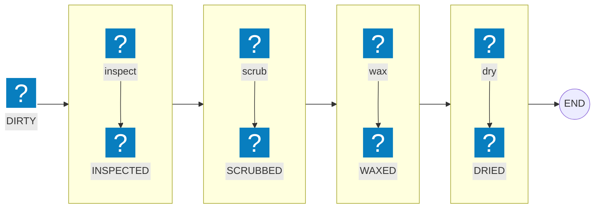

Your `Car` class has twelve methods now. Washing, waxing, polishing, billing — everything that ever needed the car's fields got bolted onto it. Nobody remembers which ones mutate state, and testing `scrub` means constructing half the object graph first.

It's the equivalent of welding the car wash onto the car: the object hauls its machinery everywhere it goes.

But don't overcorrect — some methods *do* belong on a `Car`. `car.start()`, `car.lockDoors()`, `car.unlockDoors()` are intrinsic to what a car *is*: every car needs them forever, and they touch its own mechanical state. The absurdity isn't methods on objects — it's variable services welded into data.

The boundary rule: would every instance need this behavior forever, and is it part of what the thing *is*? Engine start, door locks — keep them on the object. Washing, insuring, repairing are services the car passes through — shared logic that changes on its own schedule — so they belong outside. Functional programming gives you that clean outside: instead of moving functions to where the data lives, you move the data to the functions. The car drives through the wash. Java records made this style practical — here's what it buys you, and what it costs.

**TL;DR:** model data as plain immutable records and transform it with standalone pure functions — variable, shared behavior (washing, quoting) moves off the object; intrinsic behavior (`start()`, `lockDoors()`) stays on. You get trivially testable, composable business logic; you pay with extra object allocations — measured at ~14 vs ~2 ns for the full wash cycle on JDK 24 — about 6x, still negligible for typical business code.

## What Does "Moving Data to Functions" Mean?

The core idea is simple: instead of having data carry all of its behavior around (as in OOP), we keep data as plain values and have separate functions that operate on that data.

### OOP Style: Moving Functions to Data

In object-oriented programming, data and behavior are tightly coupled:

```java
record Owner(String id, String name) {}

class Car {
    private String plate;
    private Owner owner;
    private int dirtLevel;

    public BigDecimal quoteWash() {
        return BigDecimal.valueOf(8).add(BigDecimal.valueOf(dirtLevel * 2L));
    }

    public Car scrub() {
        return new Car(plate, owner, Math.max(0, dirtLevel - 4));
    }
}

// Usage: functions are dispatched to the data
Car car = new Car("ABC-123", owner, 9);
BigDecimal price = car.quoteWash();
Car cleaner = car.scrub();
```

Here, the functions live on the data itself. When we call a method on the object, we send the operation to where the data is - the function travels to the data, which never moves. The car carries the wash around with it — and a wash is exactly the kind of variable, external service the boundary rule says to pull off the object.

### Functional Style: Moving Data to Functions

In functional programming, data and behavior are separated:

```java
record Car(String plate, Owner owner, int dirtLevel, WashStatus status) {
    // A car rolling in off the street starts DIRTY
    public Car(String plate, Owner owner, int dirtLevel) {
        this(plate, owner, dirtLevel, WashStatus.DIRTY);
    }
}

enum WashStatus {
    DIRTY, INSPECTED, SCRUBBED, WAXED, DRIED
}

// Functions are separate and operate on data
BigDecimal quoteWash(Car car) {
    return BigDecimal.valueOf(8).add(BigDecimal.valueOf(car.dirtLevel() * 2L));
}

Car scrub(Car car) {
    return new Car(car.plate(), car.owner(), Math.max(0, car.dirtLevel() - 4), car.status());
}

// Usage: data is passed to functions
Car car = new Car("ABC-123", owner, 9);
BigDecimal price = quoteWash(car);
Car cleaner = scrub(car);
```

Here, the data is just a plain record - it stays inert, and we pass it to the functions that transform it. The wash is infrastructure; the car just rolls through it. We move data to functions.

## What You Actually Gain

### 1. Reuse One Function Across Many Types

When functions are separate from data, you can design them to work with multiple data types through interfaces or generics. In Java, since it's statically typed, you'd typically define an interface to achieve this reusability.

```java
// Define an interface for the expected shape
interface Washable {
    int dirtLevel();
}

// Now the function works with any type implementing Washable
BigDecimal quoteWash(Washable vehicle) {
    return BigDecimal.valueOf(8).add(BigDecimal.valueOf(vehicle.dirtLevel() * 2L));
}

// Washable only asks for dirtLevel() — each record keeps its other fields
record Car(String plate, Owner owner, int dirtLevel, WashStatus status) implements Washable {}
record Truck(String plate, int axles, int dirtLevel) implements Washable {}
record Motorcycle(String plate, int dirtLevel) implements Washable {}

// The same function works for all of them
Car car = new Car("ABC-123", owner, 9, WashStatus.DIRTY);
Truck truck = new Truck("TRK-77", 3, 12);
BigDecimal carPrice = quoteWash(car);
BigDecimal truckPrice = quoteWash(truck);
```

The benefit is that functions are decoupled from specific classes - they depend on abstractions (interfaces) rather than concretions. This makes it easier to reuse functions across different data structures that share the same shape, and easier to test since you can use simple test implementations.

### 2. Compose Functions Into Pipelines

Functions can be easily composed together to create complex transformations:

```java
// Compose small functions into a pipeline
Function<Car, Car> wash =
    car -> scrub(car);

Function<Car, BigDecimal> washAndQuote =
    wash.andThen(c -> quoteWash(c));

BigDecimal price = washAndQuote.apply(car);
```

Each function takes data, transforms it, and passes the result to the next function. The car flows through a pipeline of stations.

### 3. Immutability Comes Free

When we move data to functions, this approach naturally promotes immutability. Instead of modifying data in place, functions return new, transformed data:

```java
// Original car is never modified
Car dirty = new Car("ABC-123", owner, 9);
Car cleaner = scrub(dirty);
// dirty is still at dirtLevel 9
```

This eliminates a whole class of bugs related to shared mutable state. While you could technically have functions that visit and modify mutable data, the functional programming style encourages immutability as a best practice.

### 4. Test Logic With a Data Literal

Testing becomes much simpler because you can test functions with simple data literals:

```java
@Test
void scrubReducesDirt() {
    Car car = new Car("ABC-123", owner, 9);

    Car result = scrub(car);

    assertEquals(5, result.dirtLevel());
    assertEquals(9, car.dirtLevel()); // original untouched
}
```

No need to set up complex object graphs or use mocks.

> **If you take one thing from this post, take this.** The biggest win isn't purity or elegance — it's that every piece of business logic becomes a function you can test with a data literal. No container, no mocks, no 40-line `setUp()`. That alone changes how fast you can iterate.

### 5. Serialize Plain Data, No Plumbing

Plain data structures serialize and deserialize much more easily than complex object graphs with behavior:

```java
ObjectMapper objectMapper = new ObjectMapper();

// A simple record can be easily converted to JSON
Car car = new Car("ABC-123", new Owner("O-1", "John"), 9);
String json = objectMapper.writeValueAsString(car);

// And reconstructed just as easily
Car reconstructed = objectMapper.readValue(json, Car.class);
```

```text
{"plate":"ABC-123","owner":{"id":"O-1","name":"John"},"dirtLevel":9,"status":"DIRTY"}
```

## Practical Example: The Wash Cycle

Here's the approach applied to a realistic wash lane.

### The Data: Plain Records

```java
record Owner(String id, String name) {}
record Car(String plate, Owner owner, int dirtLevel, WashStatus status) implements Washable {
    // A car rolling in off the street starts DIRTY
    public Car(String plate, Owner owner, int dirtLevel) {
        this(plate, owner, dirtLevel, WashStatus.DIRTY);
    }
}

enum WashStatus {
    DIRTY, INSPECTED, SCRUBBED, WAXED, DRIED
}
```

### The Functions: One Job Each

Each function checks the state it expects, transforms, and stamps the next status — the ordering rules live in the data, not in hidden flags.

Contrast with the OOP version, where the same checks sit inside mutable methods: `wax()` called out of turn silently does nothing — or quietly corrupts state. Here a record can't be mutated at all, so the only way through the lane is to produce the next value, and a wrong order fails fast with `IllegalStateException`. Go one step further — a distinct type per status (`ScrubbedCar`, `WaxedCar`) — and the *compiler* refuses a skipped station; the enum buys you most of that safety without the extra types:

```java
Car inspect(Car car) {
    if (car.plate() == null || car.dirtLevel() == 0) {
        throw new IllegalArgumentException("Nothing to wash");
    }
    return new Car(
        car.plate(),
        car.owner(),
        car.dirtLevel(),
        WashStatus.INSPECTED
    );
}
```

Scrubbing only happens on inspected cars — the status check is what makes the pipeline reorder-proof:

```java
Car scrub(Car car) {
    if (car.status() != WashStatus.INSPECTED) {
        throw new IllegalStateException("Car must be inspected first");
    }

    return new Car(
        car.plate(),
        car.owner(),
        Math.max(0, car.dirtLevel() - 4),
        WashStatus.SCRUBBED
    );
}
```

Wax strips the last of the grime rather than adding a new field — the data model stays flat:

```java
Car wax(Car car) {
    if (car.status() != WashStatus.SCRUBBED) {
        throw new IllegalStateException("Car must be scrubbed first");
    }

    return new Car(
        car.plate(),
        car.owner(),
        Math.max(0, car.dirtLevel() - 2),
        WashStatus.WAXED
    );
}
```

The last step is just a state flip:

```java
Car dry(Car car) {
    if (car.status() != WashStatus.WAXED) {
        throw new IllegalStateException("Car must be waxed first");
    }

    return new Car(
        car.plate(),
        car.owner(),
        car.dirtLevel(),
        WashStatus.DRIED
    );
}
```

### Composing the Pipeline

The `andThen` composition from earlier scales to the full cycle — the null check stays a plain guard clause:

```java
Car runWashCycle(Car car) {
    if (car == null) {
        throw new IllegalArgumentException("Car must not be null");
    }
    Function<Car, Car> washCycle = ((Function<Car, Car>) this::inspect)
        .andThen(this::scrub)
        .andThen(this::wax)
        .andThen(this::dry);
    return washCycle.apply(car);
}
```

Notice how each function is pure (no side effects), takes data as input, and returns new data as output. The original car is never modified — each station hands the belt a new version.

Think of the data as a car on the conveyor: each station is one function — the car rolls in, gets transformed, and rolls out stamped with a new status:



## What It Actually Costs: Measured

Every pipeline step allocates a new `Car` instead of mutating in place. I ran the wash cycle above through JMH (OpenJDK 24, average time per operation, 3 forks × 5 iterations):

| Operation | Mutable | Functional |
|---|---|---|
| inspect | 2.1 ns | 2.3 ns |
| scrub | 2.3 ns | 2.2 ns |
| quoteWash | 2.3 ns | 3.2 ns |
| full cycle | 2.2 ns | 13.9 ns |

```chart
{
  "type": "bar",
  "data": {
    "labels": ["inspect", "scrub", "quoteWash", "full cycle"],
    "datasets": [
      { "label": "Mutable (ns/op)", "data": [2.1, 2.3, 2.3, 2.2] },
      { "label": "Functional (ns/op)", "data": [2.3, 2.2, 3.2, 13.9] }
    ]
  },
  "options": {
    "plugins": { "title": { "display": true, "text": "JMH avg time per op — lower is better" } }
  }
}
```

Two takeaways:

- **~6x slower end-to-end** — 13.9 ns vs 2.2 ns per car. Still nanoseconds, invisible in typical business code.
- **Per operation, the styles cost the same.** `inspect`, `scrub`, and `quoteWash` all land in the same 2–3 ns band either way, because each variant allocates roughly one object per call. The cycle gap is accumulated copies: four stations, four fresh `Car` records versus one mutated object — plus the `andThen` chain rebuilt per call (hoisting it to a `static final` field cut the same run to ~9 ns).

<details>
<summary>Raw JMH output (JMH 1.37, OpenJDK 24, avgt mode)</summary>

```text
$ java -jar blog-examples-1.0-SNAPSHOT.jar "CarWashBenchmark" -wi 3 -i 5 -f 3

Benchmark                                         Mode  Cnt   Score   Error  Units
CarWashBenchmark.benchmarkFunctionalInspect       avgt   15   2.342 ± 0.029  ns/op
CarWashBenchmark.benchmarkFunctionalQuoteWash     avgt   15   3.165 ± 0.798  ns/op
CarWashBenchmark.benchmarkFunctionalRunWashCycle  avgt   15  13.900 ± 0.282  ns/op
CarWashBenchmark.benchmarkFunctionalScrub         avgt   15   2.165 ± 0.044  ns/op
CarWashBenchmark.benchmarkMutableInspect          avgt   15   2.149 ± 0.060  ns/op
CarWashBenchmark.benchmarkMutableQuoteWash        avgt   15   2.268 ± 0.059  ns/op
CarWashBenchmark.benchmarkMutableRunWashCycle     avgt   15   2.160 ± 0.050  ns/op
CarWashBenchmark.benchmarkMutableScrub            avgt   15   2.253 ± 0.162  ns/op
```
</details>

The real risk isn't these nanoseconds — it's allocation churn under sustained load: more garbage, more GC pressure, worse cache locality. I covered that pattern in [What Is Memory Churn and How to Avoid It in Java](/post/java/memory_churn/).

### If You Do Hit a Hot Path

Mutate in place there — a method that updates `this.dirtLevel` instead of returning a new object — or try lazy evaluation, batching, and primitive streams (`IntStream` instead of `Stream<Integer>`). Profile first: the benchmark above shows the cost is real per-operation but small, so optimize only the paths a profiler actually flags.

## When This Approach Doesn't Work

The boundary rule cuts both ways — and here it's the payoff, not a disclaimer. The OOP `Car` wasn't wrong *in general*; it was wrong for *variable* behavior. `car.start()` mutating the car's own mechanical state is correctly a method — intrinsic, unchanging, part of what a car is. `car.wash()` isn't: washing is external to the car, changes independently (new wash types, new prices), and is shared logic rather than the car's identity.

Two honest caveats. Gray zones exist — is `driveTo()` intrinsic? When in doubt, apply the test: *every car, forever* versus *one workflow among many*. And a `CarWash` service object holding the wash logic is classic, perfectly fine OOP — the question is where behavior *lives*, not OOP versus FP tribal war.

Otherwise, reach for something else:

1. **When you need encapsulation**: Sometimes you need to hide internal details and control access to data. In these cases, OOP's encapsulation can be beneficial.

2. **When behavior is complex and tightly coupled to data**: If the behavior is very specific to a particular data structure and wouldn't make sense elsewhere, bundling them together might be more appropriate.

3. **When working with existing OOP frameworks**: Many Java frameworks (Spring, Hibernate, etc.) are designed around OOP principles and work best with objects.

4. **When overusing higher-order functions**: Passing functions as parameters everywhere can make code harder to navigate and debug. If a function breaks, the error occurs where it's called, but finding where it's defined can become difficult. Use higher-order functions judiciously and keep function definitions close to their usage.

## The Takeaway

Separate the *variable* behavior from the data — the intrinsic stuff (`start()`, `lockDoors()`) stays on the object where it belongs. Model state as immutable records, transform it with standalone pure functions, compose those functions into pipelines. The car shouldn't haul the wash around — it should just drive through it. The payoff is business logic you can test with a data literal and reason about one function at a time — at a cost that benchmarks show is negligible outside hot paths.

Try it on one small class this week. Take a "god object" with a handful of transformation methods, turn it into a record, and move the methods out into static functions. Then write the tests — notice how short they get.

The full benchmark code and runnable examples are in the [blog-examples](https://github.com/mmarko88/blog-examples) repo. If allocation overhead becomes a real bottleneck, read [What Is Memory Churn and How to Avoid It in Java](/post/java/memory_churn/) next.
