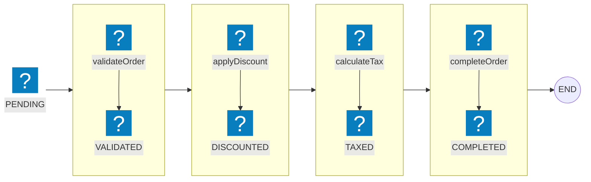

Your `Order` class has twelve methods now. Discounts, taxes, validation, totals, formatting — everything that ever needed the order's fields got added as a method. Nobody remembers which ones mutate state, and testing `applyDiscount` means constructing half the object graph first.

Functional programming pushes in the opposite direction: keep the data inert, pass it to functions. Instead of moving functions to where the data lives, you move the data to the functions. Java records made this style practical — here's what it buys you, and what it costs.

**TL;DR:** model data as plain immutable records and transform it with standalone pure functions. You get trivially testable, composable business logic; you pay with extra object allocations — measured at ~115 vs ~98 ns for the full pipeline on JDK 24, negligible for typical business code.

## What Does "Moving Data to Functions" Mean?

The core idea is simple: instead of having data carry its behavior around (as in OOP), we keep data as plain values and have separate functions that operate on that data.

### OOP Style: Moving Functions to Data

In object-oriented programming, data and behavior are tightly coupled:

```java
class Order {
    private List<Item> items;
    private Customer customer;
    
    public BigDecimal calculateTotal() {
        return items.stream()
            .map(item -> item.price().multiply(BigDecimal.valueOf(item.quantity())))
            .reduce(BigDecimal.ZERO, BigDecimal::add);
    }
    
    public Order applyDiscount(BigDecimal discount) {
        List<Item> discountedItems = items.stream()
            .map(item -> new Item(item.sku(), item.quantity(), item.price().multiply(discount)))
            .toList();
        return new Order(discountedItems, customer);
    }
}

// Usage: functions are dispatched to the data
Order order = new Order(items, customer);
BigDecimal total = order.calculateTotal();
Order discounted = order.applyDiscount(new BigDecimal("0.9"));
```

Here, the functions live on the data itself. When we call a method on the object, we send the operation to where the data is - the function travels to the data, which never moves.

### Functional Style: Moving Data to Functions

In functional programming, data and behavior are separated:

```java
record Order(List<Item> items, Customer customer) {}

// Functions are separate and operate on data
BigDecimal calculateTotal(Order order) {
    return order.items().stream()
        .map(item -> item.price().multiply(BigDecimal.valueOf(item.quantity())))
        .reduce(BigDecimal.ZERO, BigDecimal::add);
}

Order applyDiscount(Order order, BigDecimal discount) {
    List<Item> discountedItems = order.items().stream()
        .map(item -> new Item(item.sku(), item.quantity(), item.price().multiply(discount)))
        .toList();
    return new Order(discountedItems, order.customer());
}

// Usage: data is passed to functions
Order order = new Order(items, customer);
BigDecimal total = calculateTotal(order);
Order discounted = applyDiscount(order, new BigDecimal("0.9"));
```

Here, the data is just a plain record - it stays inert, and we pass it to the functions that transform it. We move data to functions.

## What You Actually Gain

### 1. Reuse One Function Across Many Types

When functions are separate from data, you can design them to work with multiple data types through interfaces or generics. In Java, since it's statically typed, you'd typically define an interface to achieve this reusability.

```java
// Define an interface for the expected shape
interface ItemContainer {
    List<Item> items();
}

// Now the function works with any type implementing ItemContainer
BigDecimal calculateTotal(ItemContainer container) {
    return container.items().stream()
        .map(item -> item.price().multiply(BigDecimal.valueOf(item.quantity())))
        .reduce(BigDecimal.ZERO, BigDecimal::add);
}

// Both Order and Invoice can implement ItemContainer
record Order(List<Item> items, Customer customer) implements ItemContainer {}
record Invoice(List<Item> items, String invoiceNumber) implements ItemContainer {}

// The same function works for both
Order order = new Order(items, customer);
Invoice invoice = new Invoice(items, "INV-001");
BigDecimal orderTotal = calculateTotal(order);
BigDecimal invoiceTotal = calculateTotal(invoice);
```

The benefit is that functions are decoupled from specific classes - they depend on abstractions (interfaces) rather than concretions. This makes it easier to reuse functions across different data structures that share the same shape, and easier to test since you can use simple test implementations.

### 2. Compose Functions Into Pipelines

Functions can be easily composed together to create complex transformations:

```java
// Compose small functions into a pipeline
Function<Order, Order> discount10 =
    order -> applyDiscount(order, new BigDecimal("0.9"));

Function<Order, BigDecimal> totalAfterDiscount =
    discount10.andThen(o -> calculateTotal(o));

BigDecimal total = totalAfterDiscount.apply(order);
```

Each function takes data, transforms it, and passes the result to the next function. The data flows through a pipeline of functions.

### 3. Immutability Comes Free

When we move data to functions, this approach naturally promotes immutability. Instead of modifying data in place, functions return new, transformed data:

```java
// Original order is never modified
Order original = new Order(items, customer);
Order discounted = applyDiscount(original, new BigDecimal("0.9"));
// original is still unchanged
```

This eliminates a whole class of bugs related to shared mutable state. While you could technically have functions that visit and modify mutable data, the functional programming style encourages immutability as a best practice.

### 4. Test Logic With a Data Literal

Testing becomes much simpler because you can test functions with simple data literals:

```java
@Test
void testCalculateTotal() {
    Order order = new Order(
        List.of(new Item("A", 1, new BigDecimal("10.00"))),
        new Customer("C-1", "John")
    );
    
    BigDecimal total = calculateTotal(order);
    assertEquals(new BigDecimal("10.00"), total);
}
```

No need to set up complex object graphs or use mocks.

> **If you take one thing from this post, take this.** The biggest win isn't purity or elegance — it's that every piece of business logic becomes a function you can test with a data literal. No container, no mocks, no 40-line `setUp()`. That alone changes how fast you can iterate.

### 5. Serialize Plain Data, No Plumbing

Plain data structures serialize and deserialize much more easily than complex object graphs with behavior:

```java
ObjectMapper objectMapper = new ObjectMapper();

// A simple record can be easily converted to JSON
Order order = new Order(items, customer);
String json = objectMapper.writeValueAsString(order);

// And reconstructed just as easily
Order reconstructed = objectMapper.readValue(json, Order.class);
```

```text
{"items":[{"sku":"A","quantity":1,"price":10.00}],"customer":{"id":"C-1","name":"John"}}
```

## Practical Example: Order Processing Pipeline

Here's the approach applied to a realistic order flow.

### The Data: Plain Records

```java
record Item(String sku, int quantity, BigDecimal price) {}
record Customer(String id, String name) {}
record Order(String id, Customer customer, List<Item> items, OrderStatus status) {}

enum OrderStatus {
    PENDING, VALIDATED, DISCOUNTED, TAXED, COMPLETED
}
```

### The Functions: One Job Each

Each function checks the state it expects, transforms, and stamps the next status — a state machine enforced by types, not by hidden flags:

```java
Order validateOrder(Order order) {
    if (order.customer() == null || order.items().isEmpty()) {
        throw new IllegalArgumentException("Invalid order");
    }
    return new Order(
        order.id(),
        order.customer(),
        order.items(),
        OrderStatus.VALIDATED
    );
}
```

Discounts only apply to validated orders — the status check is what makes the pipeline safe to reorder-proof:

```java
Order applyDiscount(Order order, BigDecimal discountRate) {
    if (order.status() != OrderStatus.VALIDATED) {
        throw new IllegalStateException("Order must be validated first");
    }
    
    List<Item> discountedItems = order.items().stream()
        .map(item -> new Item(
            item.sku(),
            item.quantity(),
            item.price().multiply(discountRate)
        ))
        .toList();
    
    return new Order(
        order.id(),
        order.customer(),
        discountedItems,
        OrderStatus.DISCOUNTED
    );
}
```

Tax becomes a line item on the order rather than a separate field — the data model stays flat:

```java
Order calculateTax(Order order, BigDecimal taxRate) {
    if (order.status() != OrderStatus.DISCOUNTED) {
        throw new IllegalStateException("Order must be discounted first");
    }
    
    BigDecimal total = order.items().stream()
        .map(item -> item.price().multiply(BigDecimal.valueOf(item.quantity())))
        .reduce(BigDecimal.ZERO, BigDecimal::add);
    
    BigDecimal tax = total.multiply(taxRate);
    
    // Add tax as a special item
    Item taxItem = new Item("TAX", 1, tax);
    List<Item> itemsWithTax = new ArrayList<>(order.items());
    itemsWithTax.add(taxItem);
    
    return new Order(
        order.id(),
        order.customer(),
        itemsWithTax,
        OrderStatus.TAXED
    );
}
```

The last step is just a state flip:

```java
Order completeOrder(Order order) {
    if (order.status() != OrderStatus.TAXED) {
        throw new IllegalStateException("Order must be taxed first");
    }
    
    return new Order(
        order.id(),
        order.customer(),
        order.items(),
        OrderStatus.COMPLETED
    );
}
```

### Composing the Pipeline

```java
Order processOrder(Order order, BigDecimal discountRate, BigDecimal taxRate) {
    return Optional.ofNullable(order)
        .map(this::validateOrder)
        .map(o -> applyDiscount(o, discountRate))
        .map(o -> calculateTax(o, taxRate))
        .map(this::completeOrder)
        .orElseThrow(() -> new IllegalArgumentException("Order must not be null"));
}
```

Notice how each function is pure (no side effects), takes data as input, and returns new data as output. The original order is never modified.

Think of the data flowing down a pipe: each segment is one function — the order goes in, gets transformed, and comes out stamped with a new status:



## What It Actually Costs: Measured

Every pipeline step allocates a new `Order` instead of mutating in place. I ran the order pipeline above through JMH (OpenJDK 24, average time per operation, 3 forks × 5 iterations):

| Operation | Mutable | Functional |
|---|---|---|
| validate | 7.5 ns | 2.5 ns |
| applyDiscount | 25.0 ns | 49.2 ns |
| calculateTotal | 31.9 ns | 44.2 ns |
| full pipeline | 98.4 ns | 114.9 ns |

```chart
{
  "type": "bar",
  "data": {
    "labels": ["validate", "applyDiscount", "calculateTotal", "full pipeline"],
    "datasets": [
      { "label": "Mutable (ns/op)", "data": [7.5, 25.0, 31.9, 98.4] },
      { "label": "Functional (ns/op)", "data": [2.5, 49.2, 44.2, 114.9] }
    ]
  },
  "options": {
    "plugins": { "title": { "display": true, "text": "JMH avg time per op — lower is better" } }
  }
}
```

Two takeaways:

- **~17% slower end-to-end** — still single-digit nanoseconds of difference per order, invisible in typical business code.
- **The cost concentrates where allocation happens.** `applyDiscount` is ~2x slower because it rebuilds the item list and the `Order`. `validate`, which allocates nothing, runs *3x faster* functionally — allocation, not the style itself, is what you pay for.

<details>
<summary>Raw JMH output (JMH 1.37, OpenJDK 24, avgt mode)</summary>

```text
$ java -jar blog-examples-1.0-SNAPSHOT.jar "OrderBenchmark" -wi 3 -i 5 -f 3

Benchmark                                         Mode  Cnt    Score    Error  Units
OrderBenchmark.benchmarkFunctionalApplyDiscount   avgt   15   49.247 ±  1.431  ns/op
OrderBenchmark.benchmarkFunctionalCalculateTotal  avgt   15   44.224 ±  3.621  ns/op
OrderBenchmark.benchmarkFunctionalProcessOrder    avgt   15  114.896 ±  1.557  ns/op
OrderBenchmark.benchmarkFunctionalValidate        avgt   15    2.539 ±  0.052  ns/op
OrderBenchmark.benchmarkMutableApplyDiscount      avgt   15   25.019 ±  1.023  ns/op
OrderBenchmark.benchmarkMutableCalculateTotal     avgt   15   31.872 ±  0.429  ns/op
OrderBenchmark.benchmarkMutableProcessOrder       avgt   15   98.391 ±  5.569  ns/op
OrderBenchmark.benchmarkMutableValidate           avgt   15    7.529 ±  1.430  ns/op
```
</details>

The real risk isn't these nanoseconds — it's allocation churn under sustained load: more garbage, more GC pressure, worse cache locality. I covered that pattern in [What Is Memory Churn and How to Avoid It in Java](/post/java/memory_churn/).

### If You Do Hit a Hot Path

Mutate in place there — a method that updates `this.items` instead of returning a new object — or try lazy evaluation, batching, and primitive streams (`IntStream` instead of `Stream<Integer>`). Profile first: the benchmark above shows the cost is real per-operation but small, so optimize only the paths a profiler actually flags.

## When This Approach Doesn't Work

This isn't a silver bullet. Reach for something else:

1. **When you need encapsulation**: Sometimes you need to hide internal details and control access to data. In these cases, OOP's encapsulation can be beneficial.

2. **When behavior is complex and tightly coupled to data**: If the behavior is very specific to a particular data structure and wouldn't make sense elsewhere, bundling them together might be more appropriate.

3. **When working with existing OOP frameworks**: Many Java frameworks (Spring, Hibernate, etc.) are designed around OOP principles and work best with objects.

4. **When overusing higher-order functions**: Passing functions as parameters everywhere can make code harder to navigate and debug. If a function breaks, the error occurs where it's called, but finding where it's defined can become difficult. Use higher-order functions judiciously and keep function definitions close to their usage.

## The Takeaway

Separate the data from the behavior: model state as immutable records, transform it with standalone pure functions, compose those functions into pipelines. The payoff is business logic you can test with a data literal and reason about one function at a time — at a cost that benchmarks show is negligible outside hot paths.

Try it on one small class this week. Take a "god object" with a handful of transformation methods, turn it into a record, and move the methods out into static functions. Then write the tests — notice how short they get.

The full benchmark code and runnable examples are in the [blog-examples](https://github.com/mmarko88/blog-examples) repo. If allocation overhead becomes a real bottleneck, read [What Is Memory Churn and How to Avoid It in Java](/post/java/memory_churn/) next.
