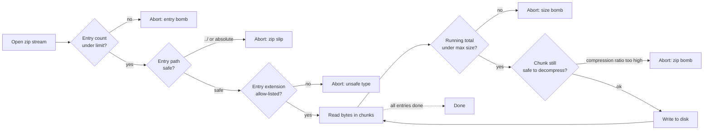

Extracting archive files without controlling resource consumption is security-sensitive and can lead to denial of service.

Our code executes on servers, but you should know that servers have limits. Based on this, check how many hardware resources your code can consume. Resources are CPU, RAM, disk, network... Understand those limits and, based on those limits, put thresholds in your code.

Here are some important thresholds you should put in a code when extracting a zip archive — in
the order they should fire during extraction:



### 1. Limit the size of an extracted archive
This is the most basic and critical threshold you should introduce when extracting a zip archive.

#### How to limit extracted size?
You can check the size after you extract the archive, but this can be too late. If the extracted content is too big, it can drain your server resources.

You should include a size threshold check in the extraction process. Each time you extract and get some bytes from an archive, compare the total extracted size with the threshold.

Zip archives also have metadata. In metadata, you can find each entry's file size. But, as another application wrote metadata, this information doesn't need to be correct.

### 2. Limit the number of entries in an archive
Each file system has some limitations in terms of the number of files and directories that can handle in a directory/partition/hard drive... Those limits are usually huge numbers. Even so, this is a limited resource. In the [Sonar article](https://rules.sonarsource.com/java/type/Security%20Hotspot/RSPEC-5042) there is the following statement:

``Too many entries in an archive, can lead to inodes exhaustion of the system.``

Inodes are indexes that point to the actual location of a file on a disk. If you have too many small files on the file system, it can drain out available inodes. Consequently, your system cannot store new files.

Inodes are used on the linux/unix file systems, but a similar limit also exists for windows. Source: [stackoverflow](https://stackoverflow.com/a/7163783).

### 3. Protect yourself against zip bomb

``Successful Zip Bomb attacks occur when an application expands untrusted archive files without controlling the size of the expanded data, which can lead to denial of service.`` Source: [Sonar article](https://rules.sonarsource.com/java/type/Security%20Hotspot/RSPEC-5042)

A Zip bomb is usually a malicious archive file of a few kilobytes with extracted content measured in gigabytes. To achieve this extreme compression ratio, attackers will compress irrelevant data (e.g., a long string of repeated bytes).

You can have a total archive file size threshold, but you should always strive to fail fast. The compression ratio can give you an idea of whether the data in the archive is relevant. The data compression ratio for most legit archives is 1 to 3. And in the example from the sonar article threshold is 10, which should be a good value.

[Here](https://www.bamsoftware.com/hacks/zipbomb/) you can find example zip bomb files.

### 4. Sanitize zip files
Sure, here is the revised version in Markdown format with grammatical corrections:

1. **Run a virus scan on a zip file before performing any other action.**

   This can help prevent malicious files from being uploaded and potentially causing harm to the server or other users.

2. **Check the content of the zip archive.**

   The content of a zip archive is stored sequentially as a sequence of bytes,
   followed by a central directory at the end of the file.
   The central directory contains metadata about all zip content.
   For each file, it contains a relative path inside the zip archive.
   This can create a problem as it can allow a ZipSlip attack
   because a user can enter the file name in the form `..\..\file`,
   leading to the extraction of a zip file in an unwanted location.

   To fix this, add the following check: the **canonical** path of the entry does not start
   with the **canonical** path of the target directory — comparing as `Path`, not as `String`.

   ```java
   File extractedFile = new File(extractDirPath, zipEntry.getName());
   Path basePath   = new File(extractDirPath).getCanonicalFile().toPath();
   Path targetPath = extractedFile.getCanonicalFile().toPath();
   if (!targetPath.startsWith(basePath)) {
       throw new SecurityException("ZipEntry outside target folder: " + zipEntry.getName());
   }
   ```

   Two subtle details that defeat real attackers:
   - **`getCanonicalFile()` on both sides** resolves symlinks and `..` segments. If the
     target directory itself is a symlink to another location (or if your runtime user
     later renames it), a non-canonical compare lets the attacker out.
   - **`Path.startsWith(Path)` not `String.startsWith(String)`** — the string compare treats
     `/tmp/safe` as a prefix of `/tmp/safe-evil/malicious.txt`. The `Path` compare matches
     only on complete path segments.

3. **Check file extensions inside the zip file.**

   They should match the file extensions that are allowed by your application.

4. **Change the filename to something generated by the application.**

   You can use UUID to generate the file name.
   This can help prevent conflicts between files and make it harder for an attacker to predict filenames,
   which can be useful in certain types of attacks.

### 5. Don't extract archives inside an archive

This will also create the same problem as with extracting folder content. It is better to go with one of the following options:

1. Treat archive files in the archive as all other files - don't extract them.
2. Check with the business if you can forbid the archive files inside an archive. You can ask this question because compressing an already compressed archive will not lead to a smaller file. \
   You can forbid archive entries by checking entry extension and mime type during the extraction process.

### 6. Don't rely only on archive entry metadata

Archives contain metadata that you can read during the extraction process. Compressing application wrote this data in an archive during the compression process.

The problem with this is that if you rely only on those properties, you need to trust a compressing application that is not in your control. Hackers can create fake metadata and crush your application.

Be careful when using zip archive metadata. Always ask yourself how attackers can abuse it to hack your extraction algorithm.

### 7. Hardenings I learned the hard way (production fixes)

The six items above cover the headline attacks. These five smaller details fixed real-world
findings in production code I maintain:

1. **Decode zip filenames with Cp437, not UTF-8.** The default `ZipInputStream` constructor
   assumes UTF-8; a hostile zip with filenames in another encoding throws
   `IllegalArgumentException` mid-stream and leaves half the archive extracted.

   ```java
   try (ZipInputStream zip = new ZipInputStream(input, Charset.forName("Cp437"))) { ... }
   ```

2. **Check the compression ratio inside the extraction loop, not after.** Checking only
   after writing the whole entry means a zip bomb has already written its gigabytes to disk
   by the time you notice.

   ```java
   while ((n = zip.read(buffer)) > 0) {
       out.write(buffer, 0, n);
       totalEntrySize += n;
       long compressed = entry.getCompressedSize();
       if (compressed > 0 && (double) totalEntrySize / compressed > thresholdRatio) {
           throw new SecurityException("Compression ratio exceeded on " + entry.getName());
       }
   }
   ```

3. **Fall back to the global size cap when `entry.getCompressedSize()` returns -1.** The ZIP
   format doesn't require compressed size to be present in the local header; some creators
   leave it as `-1` (unknown). Without a fallback, your ratio check silently skips those
   entries. Pattern:

   ```java
   if (compressed > 0) {
       // ratio check as above
   } else if (totalEntrySize > thresholdSize) {
       throw new SecurityException("Oversized unknown-ratio entry: " + entry.getName());
   }
   ```

4. **Skip directory entries explicitly.** `entry.isDirectory()` returns `true` for entries
   whose name ends in `/`. If you don't skip them, you'll try to open a file at a directory
   path and hit a confusing I/O error later.

   ```java
   if (entry.isDirectory()) { zip.closeEntry(); continue; }
   ```

5. **Clean up on exception.** If any threshold trips mid-archive, half the files are already
   on disk. Wrap the whole extraction in a try/catch and delete the output directory on any
   failure — otherwise you accumulate half-extracted archives from failed uploads.

   ```java
   try {
       // extract loop
   } catch (Exception e) {
       FileUtils.deleteDirectoryQuietly(outputDir);
       throw e;
   }
   ```

All five of these are in the `blog-examples` reference implementation linked at the top of
the post — the simpler variants in sections 1–6 are the clean teaching versions; the full
code reflects what shipped.

## Related reading

- [What Is Memory Churn and How to Avoid It in Java](/post/java/memory_churn/) — the extraction
  loop allocates one `ZipEntry` per iteration; same cache-locality thinking applies.
- [Fastest MS SQL Inserts — Part 2: JDBC Strategies](/post/java/mssqlserver/fast_insert_part2/) —
  bulk-inserting the extracted file metadata into a database uses the same batch-size reasoning
  as these thresholds.

#### Sources:
1. [Wikipedia](https://en.wikipedia.org/wiki/ZIP_%28file_format%29)
2. [The Risk of Archive Extraction](https://www.sonarsource.com/blog/the-hidden-flaws-of-archives-in-java/)
3. [OWASP - File Upload Cheat Sheet](https://cheatsheetseries.owasp.org/cheatsheets/File_Upload_Cheat_Sheet.html)