In [Part 1](/post/java/mssqlserver/persist_vs_saveall/) we watched Spring Data's `saveAll()` take
~12x longer than batched `persist()` because every entity triggers a SELECT before its INSERT. In
[Part 2](/post/java/mssqlserver/fast_insert_part2/) we switched to raw JDBC and cut the time
further. But Hibernate still sits well behind — so how close can it actually get to the bare metal?

**Three settings close ~80% of the gap to the raw Bulk Copy API:** implement `Persistable` to kill
the pre-INSERT SELECTs (~12x faster saveAll), use `StatelessSession` to drop the first-level cache
(near raw-JDBC speed), and layer `useBulkCopyForBatchInsert=true` on top (another ~2–2.5x). Combined with proper batch sizing,
this is as fast as Hibernate gets.

*Setup: 100,000 `Person` rows per test, median of 10 runs — Temurin JDK 21, SQL Server 2025
Developer on Ubuntu, i5-4690K pinned to one core at 3.5 GHz (same rig as
[Part 2](/post/java/mssqlserver/fast_insert_part2/)). Code in the
[example repo](https://github.com/mmarko88/blog-examples/tree/main/fastest-insert/part5-hibernate-tuning).*

## The saveAll Problem: SELECT Before INSERT

When you call `repository.saveAll(entities)`, Spring Data JPA checks each entity's ID. If the ID is
non-null, it assumes the entity might already exist and calls `EntityManager.merge()` — which issues
a `SELECT` before the `INSERT`. For 100,000 entities, that's 100,000 extra SELECTs.

### Fix: Implement Persistable

The fix is simple: make your entity implement `Persistable<T>` and track `isNew()` yourself —
`true` only until the entity is first persisted or loaded:

```java
// imports omitted
@Entity
@Table(name = "person")
public class PersistablePerson implements Persistable<Integer> {
    @Id
    private int personId;
    private String userName;
    private String firstName;
    private String lastName;
    private int years;

    @Transient
    private boolean isNew = true;

    @Override
    public Integer getId() { return personId; }

    @Override
    public boolean isNew() { return isNew; }

    @PostPersist
    @PostLoad
    void markNotNew() { this.isNew = false; }
}
```

When `isNew()` returns `true`, Spring Data uses `persist()` (direct INSERT) instead of `merge()`
(SELECT + INSERT). The `@PostPersist` and `@PostLoad` callbacks reset the flag after the entity is
saved or loaded from the database.

### Results

| Strategy | 100k persons (median ms) |
|----------|----------------------|
| saveAll (original, Part 1) | 26,545 |
| **saveAll + Persistable** | **2,240** |

**Persistable makes saveAll ~12x faster.** The SELECT elimination is the single biggest win —
`saveAll` now delegates straight to `persist()`.



## StatelessSession: Bare-Metal Hibernate

Hibernate's `StatelessSession` is designed for bulk operations. It bypasses:

- **First-level cache** — no entity state tracking, constant memory
- **Dirty checking** — no scanning managed entities at flush time
- **Cascading** — related entities must be inserted explicitly

```java
// imports and constructor omitted
@Repository
public class StatelessSessionInsertRepository {
    private final EntityManagerFactory entityManagerFactory;

    public void insertStateless(List<Person> people) {
        SessionFactory sf = entityManagerFactory.unwrap(SessionFactory.class);

        try (StatelessSession session = sf.openStatelessSession()) {
            session.getTransaction().begin();
            session.doWork(conn -> conn.createStatement().execute("SET NOCOUNT ON"));

            for (int i = 0; i < people.size(); i++) {
                session.insert(people.get(i));
            }

            session.getTransaction().commit();
        }
    }
}
```

### Results

| Strategy | 100k persons (median ms) |
|----------|----------------------|
| Hibernate persist (Part 1) | 2,064 |
| **StatelessSession** | **1,942** |
| JDBC PreparedStatement (Part 2) | 1,873 |
| JdbcTemplate (Part 2) | 1,873 |

**StatelessSession lands within ~4% of raw JDBC** (1,942 vs 1,873) — roughly 6% faster than batched
`persist` on the same rig. The small residual is Hibernate's SQL generation and parameter binding.





## The Killer Combo: StatelessSession + useBulkCopyForBatchInsert

Remember the `useBulkCopyForBatchInsert=true` connection string parameter from
[Part 4](/post/java/mssqlserver/fast_insert_part4/)? It transparently converts PreparedStatement
batches to SQL Server's Bulk Copy protocol. It works with StatelessSession too:

| Strategy | Normal | bulkCopy=true | Speedup |
|----------|--------|---------------|---------|
| Hibernate persist | 4,048 | 2,144 | 1.9x |
| StatelessSession | 2,650 | **1,075** | **2.5x** |
| JdbcTemplate | 3,089 | 1,373 | 2.3x |
| Plain JDBC | 3,953 | 1,516 | 2.6x |

```mermaid
xychart-beta
    title "100k inserts — bulkCopy flag off vs on (median ms)"
    x-axis ["persist", "stateless", "jdbcTmpl", "jdbc"]
    bar [4048, 2650, 3089, 3953]
    bar [2144, 1075, 1373, 1516]
```



*First bar series = flag off, second = flag on. Note the "Normal" column was re-measured in this
run's configuration, so its absolute ms differ from the table above — compare each row's speedup,
not absolute numbers across tables.*

**StatelessSession + bulkCopy=true = 1,075ms** — that's just 2x slower than the raw Bulk API
(492ms), while still using Hibernate's mapping metadata. For applications that need ORM convenience
with near-JDBC performance, this is the sweet spot.



## What batch size should you use?

The knob that matters is `hibernate.jdbc.batch_size` — that's what controls the JDBC
batch the driver actually sends. We swept it for every strategy above (100k inserts,
median of 10). *This sweep ran with the CPU unlocked, so absolute ms are lower than
the locked-3.5 GHz tables above — compare within the table.*

| `jdbc.batch_size` | persist | saveAll+Persistable | StatelessSession | persist + bulkCopy | Stateless + bulkCopy |
|------------------:|--------:|--------------------:|-----------------:|-------------------:|---------------------:|
| 100               |   2,718 |               2,812 |            2,336 |              4,748 |                3,780 |
| 500               |   2,331 |               2,486 |            2,141 |                  — |                2,342 |
| 1,000             |   2,262 |               2,448 |            2,068 |              1,716 |                1,340 |
| 5,000             |   2,294 |               2,312 |            2,024 |              1,875 |                  732 |
| 10,000            |   2,293 |               2,294 |            2,014 |              1,462 |              **683** |
| 50,000            |       — |               2,564 |            2,152 |              1,740 |                  850 |

Two takeaways:

- **Without the flag, batch size barely matters.** All plain-Hibernate paths sit at
  ~2.0–2.8 s across the whole range — JDBC round-trips aren't their bottleneck.
- **With `useBulkCopyForBatchInsert`, batch size *is* the tuning knob.** Each
  `executeBatch()` becomes one bulk-copy stream, so small batches mean thousands of
  tiny streams. StatelessSession + bulkCopy bottoms out at **~10,000** (683 ms) — it
  degrades sharply below ~1,000 and gains nothing by going to 50,000.

One gotcha: don't leave `batch_size` unset with the flag on. Hibernate verifies the
affected-row count of each insert, and the driver's bulk-copy rewrite reports `-1`,
which fails the insert outright (`ObjectOptimisticLockingFailure`). Set it to the
5,000–10,000 range and you're at the optimum.

## The one thing to remember

> **StatelessSession + `useBulkCopyForBatchInsert=true` = 1,075 ms** for 100k inserts — 2x slower
> than raw Bulk Copy (492 ms), with ORM mapping metadata still working for you. If you need
> Hibernate's convenience without paying Hibernate's full price, that's the combination.

If you can only make one change to speed up a `saveAll()` call: implement `Persistable<T>` with
`isNew = true`. It eliminates the pre-INSERT SELECTs and makes `saveAll` ~12x faster — a 10-line
code change for a ~12x result.

## Test yourself



<!--
Next: [Part 6 — Parallel Inserts](/post/java/mssqlserver/fast_insert_part6/) splits the data across
multiple connections to see how far parallel threads can push it.
-->
