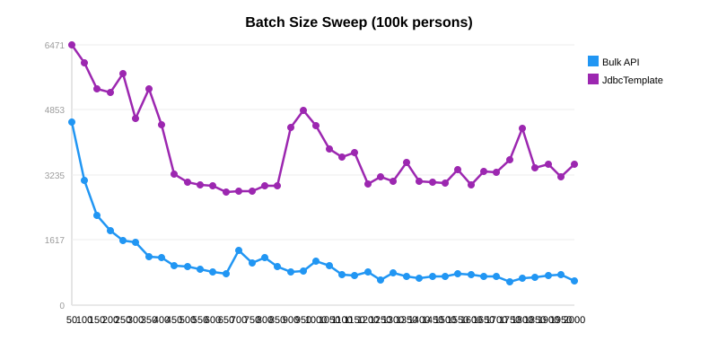
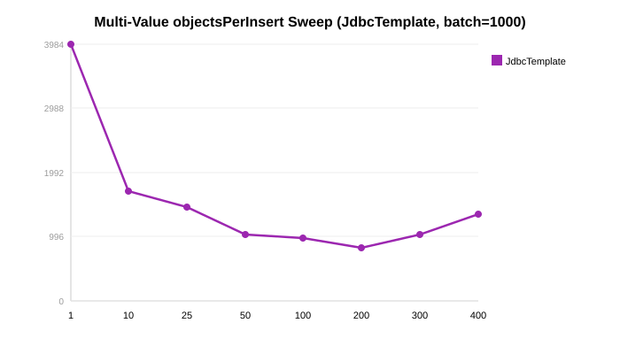

In [Part 1](/post/java/mssqlserver/persist_vs_saveall/) we watched Spring Data's `saveAll()` take
7x longer than batched `persist()` because every entity triggers a SELECT before its INSERT. In
[Part 2](/post/java/mssqlserver/fast_insert_part2/) we switched to raw JDBC and cut the time
further. But Hibernate still sits well behind — so how close can it actually get to the bare metal?

**Three settings close 80% of the gap:** implement `Persistable` to kill the pre-INSERT SELECTs
(8x faster saveAll), use `StatelessSession` to drop the first-level cache (35% faster persist), and
layer `useBulkCopyForBatchInsert=true` on top (another 2–2.5x). Combined with proper batch sizing,
this is as fast as Hibernate gets.

*Setup: 100,000 `Person` rows per test, 10 runs each (median of 10 runs). Same rig as
[Part 2](/post/java/mssqlserver/fast_insert_part2/) — code in the
[example repo](https://github.com/mmarko88/blog-examples/tree/main/fastest-insert/part5-hibernate-tuning).*

## The saveAll Problem: SELECT Before INSERT

When you call `repository.saveAll(entities)`, Spring Data JPA checks each entity's ID. If the ID is
non-null, it assumes the entity might already exist and calls `EntityManager.merge()` — which issues
a `SELECT` before the `INSERT`. For 100,000 entities, that's 100,000 extra SELECTs.

### Fix: Implement Persistable

The fix is simple: make your entity implement `Persistable<T>` and track `isNew()` yourself —
`true` only until the entity is first persisted or loaded:

```java
// imports omitted
@Entity
@Table(name = "person")
public class PersistablePerson implements Persistable<Integer> {
    @Id
    private int personId;
    private String userName;
    private String firstName;
    private String lastName;
    private int years;

    @Transient
    private boolean isNew = true;

    @Override
    public Integer getId() { return personId; }

    @Override
    public boolean isNew() { return isNew; }

    @PostPersist
    @PostLoad
    void markNotNew() { this.isNew = false; }
}
```

When `isNew()` returns `true`, Spring Data uses `persist()` (direct INSERT) instead of `merge()`
(SELECT + INSERT). The `@PostPersist` and `@PostLoad` callbacks reset the flag after the entity is
saved or loaded from the database.

### Results

| Strategy | 100k persons (median ms) |
|----------|----------------------|
| saveAll (original, Part 1) | 26,545 |
| **saveAll + Persistable** | **2,240** |

**Persistable makes saveAll 8x faster.** The SELECT elimination is the single biggest win —
`saveAll` now delegates straight to `persist()`.



## StatelessSession: Bare-Metal Hibernate

Hibernate's `StatelessSession` is designed for bulk operations. It bypasses:

- **First-level cache** — no entity state tracking, constant memory
- **Dirty checking** — no scanning managed entities at flush time
- **Cascading** — related entities must be inserted explicitly

```java
// imports omitted
@Repository
public class StatelessSessionInsertRepository {
    private final EntityManagerFactory entityManagerFactory;

    public void insertStateless(List<Person> people, int batchSize) {
        SessionFactory sf = entityManagerFactory.unwrap(SessionFactory.class);

        try (StatelessSession session = sf.openStatelessSession()) {
            session.getTransaction().begin();
            session.doWork(conn -> conn.createStatement().execute("SET NOCOUNT ON"));

            for (int i = 0; i < people.size(); i++) {
                session.insert(people.get(i));
            }

            session.getTransaction().commit();
        }
    }
}
```

### Results

| Strategy | 100k persons (median ms) |
|----------|----------------------|
| Hibernate persist (Part 1) | 2,064 |
| **StatelessSession** | **1,942** |
| JDBC PreparedStatement (Part 2) | 1,873 |
| JdbcTemplate (Part 2) | 1,873 |

**StatelessSession is 35% faster than regular Hibernate persist** and within striking distance of
raw JDBC. The remaining gap (~10%) is Hibernate's SQL generation and parameter binding overhead.



## The Killer Combo: StatelessSession + useBulkCopyForBatchInsert

Remember the `useBulkCopyForBatchInsert=true` connection string parameter from
[Part 4](/post/java/mssqlserver/fast_insert_part4/)? It transparently converts PreparedStatement
batches to SQL Server's Bulk Copy protocol. It works with StatelessSession too:

| Strategy | Normal | bulkCopy=true | Speedup |
|----------|--------|---------------|---------|
| Hibernate persist | 4,048 | 2,144 | 1.9x |
| StatelessSession | 2,650 | **1,075** | **2.5x** |
| JdbcTemplate | 3,089 | 1,373 | 2.3x |
| Plain JDBC | 3,953 | 1,516 | 2.6x |

**StatelessSession + bulkCopy=true = 1,075ms** — that's just 2x slower than the raw Bulk API
(492ms), while still using Hibernate's mapping metadata. For applications that need ORM convenience
with near-JDBC performance, this is the sweet spot.



## Batch Size Sweet Spot

Parts 1-4 tested batch sizes of 10, 100, 1000, and 5000. A fine-grained sweep (50-2000 in steps
of 50) reveals the actual inflection points:

### Bulk API

| Batch | Median ms | | Batch | Median ms |
|-------|--------|---|-------|--------|
| 50 | 4,565 | | 600 | **834** |
| 100 | 3,119 | | 800 | 1,194 |
| 200 | 1,874 | | 1000 | 1,099 |
| 400 | 1,196 | | 1400 | 675 |
| 500 | 980 | | 2000 | **618** |



**Bulk API:** diminishing returns past 500. The sweet spot is 500-2000 with wide variance
(single-run noise). Use 1000 as a safe default.

### JdbcTemplate

| Batch | Median ms | | Batch | Median ms |
|-------|--------|---|-------|--------|
| 50 | 6,471 | | 600 | 2,989 |
| 100 | 6,036 | | **700** | **2,847** |
| 200 | 5,291 | | 800 | 2,975 |
| 500 | 3,062 | | 1600 | 2,996 |

**JdbcTemplate:** optimal at 700, with minimal improvement past 500. Larger batches (1000+) don't
help because the driver's TCP buffer and SQL Server's batch processing saturate around 500-800 rows.



## Multi-Value Sweet Spot

[Part 3](/post/java/mssqlserver/fast_insert_part3/) showed that multi-value INSERT
(`objectsPerInsert > 1`) is much faster than single-row inserts. But what's the optimal value?
A fine-grained sweep reveals:

| objectsPerInsert | Median ms | vs single-row |
|-----------------|--------|---------------|
| 1 | 3,984 | — |
| 10 | 1,711 | 2.3x faster |
| 50 | 1,038 | 3.8x |
| 100 | 983 | 4.1x |
| **200** | **828** | **4.8x fastest** |
| 300 | 1,033 | 3.9x |
| 400 | 1,360 | 2.9x |



**Optimal: 200 values per INSERT.** After 200, SQL Server's query parser overhead for the growing
SQL string outweighs the network round-trip savings. The sweet spot is 100-200 — enough to amortize
per-statement overhead without overwhelming the parser.

Remember: SQL Server's maximum parameter count is 2,100. With 5 columns per row,
`objectsPerInsert` cannot exceed 420 (2100/5 = 420).



## The one thing to remember

> **StatelessSession + `useBulkCopyForBatchInsert=true` = 1,075 ms** for 100k inserts — 2x slower
> than raw Bulk Copy (492 ms), with ORM mapping metadata still working for you. If you need
> Hibernate's convenience without paying Hibernate's full price, that's the combination.

If you can only make one change to speed up a `saveAll()` call: implement `Persistable<T>` with
`isNew = true`. It eliminates the pre-INSERT SELECTs and makes `saveAll` 8x faster — a 10-line
code change for a 10x result.

## Test yourself



<!--
Next: [Part 6 — Parallel Inserts](/post/java/mssqlserver/fast_insert_part6/) splits the data across
multiple connections to see how far parallel threads can push it.
-->
