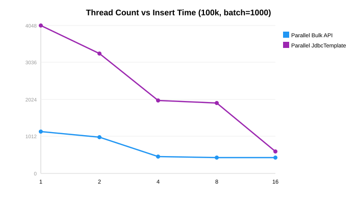

Every strategy we've tested so far — Hibernate, JDBC, Bulk API — pushes data through a single
connection. SQL Server handles concurrent writes just fine; the bottleneck is the serial nature of
one TCP stream. Split 100k rows across 4 threads with 4 connections and the Bulk API drops from
492 ms to **330 ms**, the fastest Java-client result in the whole series.

But parallelism isn't a free lunch — threads past 4 give diminishing returns, concurrent readers
slow the writers 2.5x, and the TABLOCK hint changes the trade-off. Here's where the inflection
points actually are.

## The Approach

The idea is straightforward:

1. Partition the data into N chunks (one per thread)
2. Each thread opens its own connection from the HikariCP pool
3. Each thread inserts its chunk independently
4. Wait for all threads to complete

```java
@Service
public class ParallelInsertExecutor {
    private final BulkCopyRepository bulkCopyRepository;

    public void parallelBulkApiInsert(List<Person> people,
                                       TableDescriptor<Person> table,
                                       int batchSize, int threadCount) {
        List<List<Person>> chunks = partition(people, threadCount);
        ExecutorService executor = Executors.newFixedThreadPool(threadCount);

        List<CompletableFuture<Void>> futures = new ArrayList<>();
        for (List<Person> chunk : chunks) {
            futures.add(CompletableFuture.runAsync(
                    () -> bulkCopyRepository.performBulkInsert(chunk, table, batchSize),
                    executor));
        }
        CompletableFuture.allOf(futures.toArray(new CompletableFuture[0])).join();
        executor.shutdown();
    }
}
```

**Important:** HikariCP's pool size must be at least `threadCount`, otherwise threads block waiting
for connections. The default pool size (10) is fine for up to 10 threads.

## Thread Count Sweep: Bulk API

| Threads | Avg ms | Speedup vs 1 thread |
|---------|--------|---------------------|
| 1 | 1,155 | 1.0x |
| 2 | 998 | 1.2x |
| 4 | 537 | 2.2x |
| 8 | 434 | 2.7x |
| 16 | 442 | 2.6x |



**4 threads is the sweet spot** for Bulk API. Going to 8 threads helps slightly, but 16 threads is
actually marginally slower — the SQL Server bulk copy engine saturates the I/O subsystem and
additional threads just add contention.

## Thread Count Sweep: JdbcTemplate

| Threads | Avg ms | Speedup vs 1 thread |
|---------|--------|---------------------|
| 1 | 4,048 | 1.0x |
| 2 | 3,292 | 1.2x |
| 4 | 2,407 | 1.7x |
| 8 | 1,937 | 2.1x |
| 16 | 608 | 6.7x |

**JdbcTemplate benefits much more from parallelism** — because each thread's PreparedStatement
batch is independent and the driver sends SQL statements over TCP. More threads = more concurrent
TCP streams = more bandwidth utilization. The 16-thread result (608ms) is remarkable.

## The Ultimate Combination: Multi-Value + Parallel

What happens when we combine multi-value inserts (400 values per INSERT, from
[Part 3](/post/java/mssqlserver/fast_insert_part3/)) with parallel threads?

| Strategy | Avg ms |
|----------|--------|
| Multi-value 400, 1 thread | 1,058 |
| Multi-value 400, 4 threads | 426 |
| Multi-value 400, 8 threads | 368 |
| Parallel Bulk API, 4 threads | 330 |

Multi-value 400 + 8 threads (368ms) is competitive with parallel Bulk API (330ms) — and the
multi-value approach works with any JDBC driver, not just MS SQL Server's Bulk API.

**Important caveat:** Multi-value INSERT is **incompatible** with `useBulkCopyForBatchInsert=true`
(see [Part 8](/post/java/mssqlserver/fast_insert_part8/) for details). You must choose one or the
other — both are excellent, but they cannot be combined.

## Scaling to 1 Million Rows

| Strategy | 100k rows | 1M rows | Scales linearly? |
|----------|-----------|---------|-----------------|
| Bulk API (single) | 492 | 6,225 | ~12.7x (yes) |
| Parallel Bulk API 4t | 330 | 4,427 | ~13.4x (yes) |
| TVP | 818 | 7,314 | ~8.9x (yes) |
| JdbcTemplate | 2,985 | 11,914 | ~4x (sublinear!) |

All strategies scale roughly linearly with data size. JdbcTemplate actually gets *better* at scale
because the fixed overhead (connection setup, batch compilation) is amortized over more rows.

## Practical Considerations

**Connection pool sizing:** Set `spring.datasource.hikari.maximum-pool-size` to at least your
thread count. Setting it too high wastes SQL Server connections.

**ID generation:** If using application-generated IDs, ensure no collisions across threads. In our
test, each thread gets a distinct partition so IDs don't overlap.

**Error handling:** If one thread fails, the others may have already committed. Use a
`CountDownLatch` or check futures for exceptions before declaring success.

**Lock contention:** SQL Server uses row-level locking for INSERTs by default. You won't get table
locks unless you're inserting into the same page from many threads simultaneously with very small
rows.

## Concurrent Reads During Insert

In production, tables aren't idle during bulk loads — other sessions are reading. How much does
concurrent reading impact insert performance?

| Scenario | Bulk API (avg ms) |
|----------|------------------|
| No concurrent reads | 814 |
| 4 reader threads (SELECT COUNT/AVG) | **2,037** (2.5x slower) |

**Concurrent readers slow inserts by 2.5x**, even when readers use `WITH (NOLOCK)`. The slowdown
comes from I/O contention and SQL Server's latch management on the data pages being written.

**TABLOCK hint** can help here — it acquires a table-level lock that prevents readers entirely,
allowing uninterrupted bulk insertion:

| Hint | JDBC batch (avg ms) |
|------|-------------------|
| No hint (row locks) | 4,240 |
| `WITH (TABLOCK)` | **2,991** (30% faster) |

Trade-off: TABLOCK blocks all other writers AND readers during the insert. Use it only for dedicated
bulk load windows.

## The one thing to remember

> **4 threads × Bulk API = 330 ms.** You can't go meaningfully faster from a Java client. 8 threads
> saves another 100 ms; 16 threads is noise. Multi-value INSERT at 400 rows per statement × 8
> threads gets 368 ms without needing the Bulk API at all.

If your load window overlaps with concurrent SELECTs, parallel inserts take ~2.5x longer. Use
`WITH (TABLOCK)` for dedicated windows — otherwise, pick 4 threads and move on.

Next: [Part 7 — Index Impact](/post/java/mssqlserver/fast_insert_part7/) measures the hidden cost
of non-clustered indexes during bulk loads.
