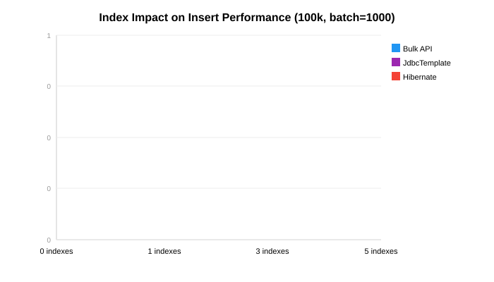

## Introduction

So far, all our benchmarks ran against a table with only a primary key (the clustered index).
Production tables typically have several non-clustered indexes for query performance. Every INSERT
must update each non-clustered index's B-tree — how much does this cost?

## The Test

We create 0, 1, 3, or 5 non-clustered indexes on the `person` table, then run the same 100,000-row
insert with three strategies: Bulk API, JdbcTemplate, and Hibernate persist.

```java
@Service
public class IndexBenchmarkHelper {
    private final JdbcTemplate jdbcTemplate;

    // Five indexes representing realistic patterns
    private static final List<IndexDef> ALL_INDEXES = Arrays.asList(
        new IndexDef("IX_person_username",        "person", "user_name"),
        new IndexDef("IX_person_lastname",        "person", "last_name"),
        new IndexDef("IX_person_firstname",       "person", "first_name"),
        new IndexDef("IX_person_years",           "person", "years"),
        new IndexDef("IX_person_name_composite",  "person", "last_name, first_name")
    );

    public void setIndexCount(int count) {
        dropAllIndexes();
        for (int i = 0; i < count; i++) {
            createIndex(ALL_INDEXES.get(i));
        }
    }
}
```

The indexes represent a mix of:
- **Selective** columns (username — unique values)
- **Low-selectivity** columns (years — few distinct values)
- **Composite** indexes (last_name + first_name)

## Results

### Bulk API

| Indexes | Avg ms | Slowdown vs 0 |
|---------|--------|---------------|
| 0 | 784 | — |
| 1 | 1,829 | +133% |
| 3 | 3,632 | +363% |
| 5 | 5,290 | +575% |

### JdbcTemplate

| Indexes | Avg ms | Slowdown vs 0 |
|---------|--------|---------------|
| 0 | 4,572 | — |
| 1 | 5,672 | +24% |
| 3 | 6,614 | +45% |
| 5 | 10,330 | +126% |

### Hibernate Persist

| Indexes | Avg ms | Slowdown vs 0 |
|---------|--------|---------------|
| 0 | 3,209 | — |
| 1 | 4,676 | +46% |
| 3 | 7,563 | +136% |
| 5 | 8,564 | +167% |



## Analysis

### Bulk API is the most sensitive

With 0 indexes, Bulk API is by far the fastest (784ms). But with 5 indexes, it's 5,290ms — slower
than JdbcTemplate with 0 indexes. The reason: Bulk API uses minimal-logging INSERT operations that
bypass some of the normal logging overhead. But when non-clustered indexes exist, the engine must
update each index B-tree for every row, and this overhead dominates.

### JdbcTemplate is the most resilient

JdbcTemplate's index penalty is relatively modest: only 2.3x slower with 5 indexes vs 0. Since
JdbcTemplate sends standard INSERT statements, the SQL Server optimizer can plan the index
maintenance more efficiently.

### The crossover point

With 3+ indexes, all strategies converge to similar performance. The strategy choice matters less
when index maintenance dominates the insert cost.

## Practical Implications

1. **Drop indexes before bulk loads** if possible. Recreating them after is often faster than
   maintaining them during the insert.

2. **Choose your strategy based on your table's index count:**
   - 0-1 indexes: Bulk API is king
   - 3+ indexes: JdbcTemplate or Hibernate — the overhead is comparable
   - Many indexes: Consider `ALTER INDEX ... DISABLE` before load, then rebuild

3. **Composite indexes cost the same** as single-column indexes for insert overhead. A composite
   index on `(last_name, first_name)` costs the same as two separate single-column indexes.

4. **Filtered indexes** (with a WHERE clause) are cheaper — they only need updating when the
   inserted row matches the filter.

## Summary

| Indexes | Best strategy | Avg ms |
|---------|--------------|--------|
| 0 | Bulk API | 784 |
| 1 | Bulk API | 1,829 |
| 3 | Hibernate | 7,563 (all strategies ~similar) |
| 5 | Hibernate | 8,564 (all strategies ~similar) |

Indexes are the hidden cost of bulk inserts. A table with 5 non-clustered indexes is **6-7x slower**
to insert into than a table with only a primary key, regardless of strategy.

## Bonus: Row Size, Compression, and Columnstore

### Row size impact

Wider rows = proportionally slower inserts, regardless of strategy:

| Row Type | Columns | ~Row Size | 100k rows (avg ms) |
|----------|---------|-----------|-------------------|
| Narrow (person) | 5 | ~60 bytes | 3,699 |
| Wide (20 cols) | 17 | ~1.5 KB | 6,952 (1.9x slower) |
| LOB (NVARCHAR(MAX)) | 7 | ~3 KB | 9,834 (2.7x slower per row, 50k rows) |

LOB columns (NVARCHAR(MAX)) force row-overflow storage and out-of-row allocation, adding
significant I/O overhead beyond the raw data size increase.


### Data compression

SQL Server supports ROW and PAGE compression on tables:

| Compression | 100k rows (avg ms) | vs None |
|-------------|-------------------|---------|
| None | 2,417 | — |
| ROW | 2,595 | +7% slower |
| PAGE | 3,229 | +33% slower |

**Compression makes inserts slower**, not faster. The CPU overhead of compressing each row or page
outweighs any I/O savings. For narrow rows like our `person` table, compression adds cost without
meaningful space savings. Compression is a read optimization (smaller pages = faster scans), not a
write optimization.

### Columnstore index

Columnstore indexes store data in compressed column segments rather than row pages. They excel at
analytical queries but have different insert characteristics:

| Table Type | Batch Size | 100k rows (avg ms) |
|------------|-----------|-------------------|
| B-tree (clustered PK) | 1,000 | 2,417 |
| Columnstore | 1,000 | 8,402 (3.5x slower) |
| Columnstore | 5,000 | 4,880 (2x slower) |

Columnstore inserts are slower because data goes into a **delta store** (a hidden B-tree rowgroup)
until it reaches ~1 million rows, then gets compressed into a columnstore segment. Larger batch
sizes help because they fill the delta store faster, triggering compression sooner.

### Heap + TABLOCK (minimal logging)

A heap table (no clustered index) with the TABLOCK hint enables minimal logging in SIMPLE/BULK_LOGGED
recovery mode:

| Table | Hint | 100k rows (avg ms) |
|-------|------|-------------------|
| Clustered PK (person) | None | 2,401 |
| Clustered PK (person) | TABLOCK | 2,185 (9% faster) |
| Heap (no PK) | None | 4,073 |
| Heap (no PK) | TABLOCK | 2,579 (37% faster) |

The heap without TABLOCK is surprisingly slow — without a clustered index, SQL Server uses IAM-driven
allocation which leads to page contention. TABLOCK fixes this by allowing bulk allocation. But a
clustered table with TABLOCK is still fastest overall.

### BCP (bcp.exe) — the external baseline

The `bcp` command-line utility is SQL Server's native bulk loader:

```bash
bcp testdb.dbo.person in data.txt -c -t"\t" -S localhost,1433 -U weblogic -P weblogic -b 1000
```

| Method | 100k rows (avg ms) |
|--------|-------------------|
| BCP utility | **843** |
| Java Bulk API | 691 |
| Java parallel Bulk API 4t | 330 |

**BCP (843ms) is slower than the Java Bulk API (691ms).** This is because BCP reads from a flat file
(disk I/O) while our Java tests generate data in memory. BCP also does not parallelize across
connections. The Java Bulk API over in-memory data is the actual performance ceiling.

### Fill factor tuning

The clustered index fill factor controls how full each page is filled during index creation/rebuild.
Lower fill factor = more empty space per page = fewer page splits during random-key inserts, at the
cost of more pages (larger table size, more I/O on reads).

| Fill Factor | Bulk API (avg ms) | JdbcTemplate (avg ms) |
|-------------|-------------------|----------------------|
| 50 | 1,762 | 5,377 |
| 70 | 1,199 | 4,252 |
| 90 | 869 | 3,395 |
| **100 (default)** | **916** | **3,337** |

**Fill factor 100 is fastest for sequential inserts** — which makes sense: our test inserts
monotonically increasing IDs, so there are no page splits regardless of fill factor. Lower fill
factors just waste space. Lower fill factors (70-80) help when you have **random-key inserts** or
heavy update patterns that cause page splits.

### Partitioning & SWITCH

SQL Server partitioning splits a table into independent chunks on-disk. The **SWITCH PARTITION**
command atomically swaps a staging table into a partition — a **metadata-only operation** that
takes milliseconds regardless of row count:

```sql
-- Partition function and scheme
CREATE PARTITION FUNCTION pf_person(INT) AS RANGE LEFT FOR VALUES (25000, 50000, 75000);
CREATE PARTITION SCHEME ps_person AS PARTITION pf_person ALL TO ([PRIMARY]);

-- SWITCH operation (metadata-only, no data movement)
ALTER TABLE person_staging SWITCH TO person_partitioned PARTITION 4;
```

| Method | 100k rows (avg ms) |
|--------|-------------------|
| Direct insert into partitioned table | 4,652 |
| SWITCH pattern (bulk-load heap, then SWITCH) | **3,470** (25% faster) |

The SWITCH pattern is faster because the heavy work (bulk loading) happens on an unpartitioned heap
table, and only the final metadata update touches the partitioned table. This is the industry
standard for **zero-downtime bulk loads** — the main table stays queryable throughout the load.

**Caveat:** The staging table must have an identical schema plus a CHECK constraint matching the
target partition's range. Both tables must live on the same filegroup.


### Temp table staging

A common ETL pattern: INSERT into a heap temp table, then INSERT-SELECT into the real table:

| Method | 100k rows (avg ms) |
|--------|-------------------|
| Direct insert | 2,401 |
| Temp table staging | 4,822 (2x slower) |

**Staging is slower for simple inserts** because you're writing data twice. It's useful when you need
to validate, deduplicate, or transform data before loading — not for raw throughput.

Next: [Part 8 — TVP and Plain JDBC](/post/java/mssqlserver/fast_insert_part8/) explores
Table-Valued Parameters and bare-metal JDBC without any ORM overhead.
