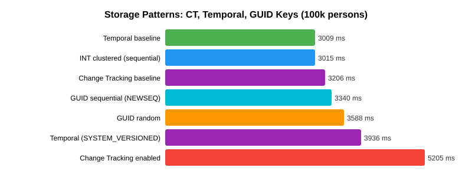
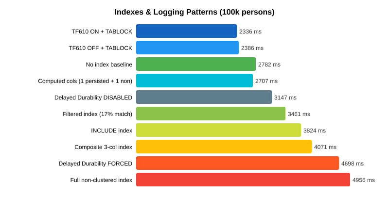
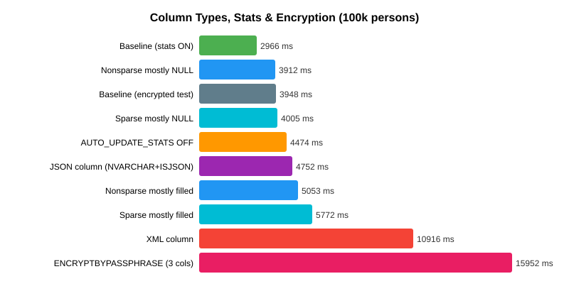
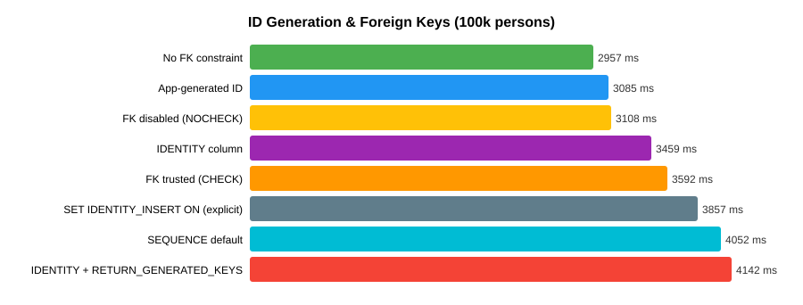

Every production table has indexes. Every INSERT has to maintain them. Add 5 non-clustered indexes
to a table and the Bulk API — the fastest single-thread strategy — slows down **7x**. The other
strategies converge: with enough indexes, the choice of insert strategy stops mattering because
index maintenance dominates.

But that's only the start. The surrounding **table design decisions** matter as much: row width,
compression, columnstore, fill factor, GUID vs INT keys, change tracking, temporal history,
JSON/XML indexes, statistics auto-update, encryption, and so on all impose their own INSERT
tax — and some of them are **counter-intuitive** (compression makes inserts slower; stats OFF makes
them slower; sparse columns are worse than nothing when filled).

This post measures them all. If you only read the first table, [index count](#results) is the
headline — but the rest of the post is where the surprises live.

## The Test

We create 0, 1, 3, or 5 non-clustered indexes on the `person` table, then run the same 100,000-row
insert with three strategies: Bulk API, JdbcTemplate, and Hibernate persist.

```java
@Service
public class IndexBenchmarkHelper {
    private final JdbcTemplate jdbcTemplate;

    // Five indexes representing realistic patterns
    private static final List<IndexDef> ALL_INDEXES = Arrays.asList(
        new IndexDef("IX_person_username",        "person", "user_name"),
        new IndexDef("IX_person_lastname",        "person", "last_name"),
        new IndexDef("IX_person_firstname",       "person", "first_name"),
        new IndexDef("IX_person_years",           "person", "years"),
        new IndexDef("IX_person_name_composite",  "person", "last_name, first_name")
    );

    public void setIndexCount(int count) {
        dropAllIndexes();
        for (int i = 0; i < count; i++) {
            createIndex(ALL_INDEXES.get(i));
        }
    }
}
```

The indexes represent a mix of:
- **Selective** columns (username — unique values)
- **Low-selectivity** columns (years — few distinct values)
- **Composite** indexes (last_name + first_name)

## Results

### Bulk API

| Indexes | Avg ms | Slowdown vs 0 |
|---------|--------|---------------|
| 0 | 784 | — |
| 1 | 1,829 | +133% |
| 3 | 3,632 | +363% |
| 5 | 5,290 | +575% |

### JdbcTemplate

| Indexes | Avg ms | Slowdown vs 0 |
|---------|--------|---------------|
| 0 | 4,572 | — |
| 1 | 5,672 | +24% |
| 3 | 6,614 | +45% |
| 5 | 10,330 | +126% |

### Hibernate Persist

| Indexes | Avg ms | Slowdown vs 0 |
|---------|--------|---------------|
| 0 | 3,209 | — |
| 1 | 4,676 | +46% |
| 3 | 7,563 | +136% |
| 5 | 8,564 | +167% |


## Analysis

### Bulk API is the most sensitive

With 0 indexes, Bulk API is by far the fastest (784ms). But with 5 indexes, it's 5,290ms — slower
than JdbcTemplate with 0 indexes. The reason: Bulk API uses minimal-logging INSERT operations that
bypass some of the normal logging overhead. But when non-clustered indexes exist, the engine must
update each index B-tree for every row, and this overhead dominates.

### JdbcTemplate is the most resilient

JdbcTemplate's index penalty is relatively modest: only 2.3x slower with 5 indexes vs 0. Since
JdbcTemplate sends standard INSERT statements, the SQL Server optimizer can plan the index
maintenance more efficiently.

### The crossover point

With 3+ indexes, all strategies converge to similar performance. The strategy choice matters less
when index maintenance dominates the insert cost.

## Practical Implications

1. **Drop indexes before bulk loads** if possible. Recreating them after is often faster than
   maintaining them during the insert.

2. **Choose your strategy based on your table's index count:**
   - 0-1 indexes: Bulk API is king
   - 3+ indexes: JdbcTemplate or Hibernate — the overhead is comparable
   - Many indexes: Consider `ALTER INDEX ... DISABLE` before load, then rebuild

3. **Composite indexes cost the same** as single-column indexes for insert overhead. A composite
   index on `(last_name, first_name)` costs the same as two separate single-column indexes.

4. **Filtered indexes** (with a WHERE clause) are cheaper — they only need updating when the
   inserted row matches the filter.

## Index count: the summary

| Indexes | Fastest strategy | Avg ms | Slowdown vs 0 |
|---------|------------------|--------|---------------|
| 0 | Bulk API | 784 | — |
| 1 | Bulk API | 1,829 | 2.3x |
| 3 | ~Any (converges) | 7,563 | 10x |
| 5 | ~Any (converges) | 8,564 | 11x |

A table with 5 non-clustered indexes is 6-11x slower to load than one with just the clustered PK —
and the choice of insert strategy barely matters anymore. The actionable advice: **disable
non-essential indexes before bulk loads, rebuild them after**.

## Beyond Indexes: Table Design & Logging Choices

The index count is only one dimension of INSERT cost. Below are 10 more table-design decisions
that each add their own tax, in order of magnitude:

### Row size impact

Wider rows = proportionally slower inserts, regardless of strategy:

| Row Type | Columns | ~Row Size | 100k rows (avg ms) |
|----------|---------|-----------|-------------------|
| Narrow (person) | 5 | ~60 bytes | 3,699 |
| Wide (20 cols) | 17 | ~1.5 KB | 6,952 (1.9x slower) |
| LOB (NVARCHAR(MAX)) | 7 | ~3 KB | 9,834 (2.7x slower per row, 50k rows) |

LOB columns (NVARCHAR(MAX)) force row-overflow storage and out-of-row allocation, adding
significant I/O overhead beyond the raw data size increase.


### Data compression

SQL Server supports ROW and PAGE compression on tables:

| Compression | 100k rows (avg ms) | vs None |
|-------------|-------------------|---------|
| None | 2,417 | — |
| ROW | 2,595 | +7% slower |
| PAGE | 3,229 | +33% slower |

**Compression makes inserts slower**, not faster. The CPU overhead of compressing each row or page
outweighs any I/O savings. For narrow rows like our `person` table, compression adds cost without
meaningful space savings. Compression is a read optimization (smaller pages = faster scans), not a
write optimization.

### Columnstore index

Columnstore indexes store data in compressed column segments rather than row pages. They excel at
analytical queries but have different insert characteristics:

| Table Type | Batch Size | 100k rows (avg ms) |
|------------|-----------|-------------------|
| B-tree (clustered PK) | 1,000 | 2,417 |
| Columnstore | 1,000 | 8,402 (3.5x slower) |
| Columnstore | 5,000 | 4,880 (2x slower) |

Columnstore inserts are slower because data goes into a **delta store** (a hidden B-tree rowgroup)
until it reaches ~1 million rows, then gets compressed into a columnstore segment. Larger batch
sizes help because they fill the delta store faster, triggering compression sooner.

### Heap + TABLOCK (minimal logging)

A heap table (no clustered index) with the TABLOCK hint enables minimal logging in SIMPLE/BULK_LOGGED
recovery mode:

| Table | Hint | 100k rows (avg ms) |
|-------|------|-------------------|
| Clustered PK (person) | None | 2,401 |
| Clustered PK (person) | TABLOCK | 2,185 (9% faster) |
| Heap (no PK) | None | 4,073 |
| Heap (no PK) | TABLOCK | 2,579 (37% faster) |

The heap without TABLOCK is surprisingly slow — without a clustered index, SQL Server uses IAM-driven
allocation which leads to page contention. TABLOCK fixes this by allowing bulk allocation. But a
clustered table with TABLOCK is still fastest overall.

### BCP (bcp.exe) — the external baseline

The `bcp` command-line utility is SQL Server's native bulk loader:

```bash
bcp testdb.dbo.person in data.txt -c -t"\t" -S localhost,1433 -U weblogic -P weblogic -b 1000
```

| Method | 100k rows (avg ms) |
|--------|-------------------|
| BCP utility | **843** |
| Java Bulk API | 691 |
| Java parallel Bulk API 4t | 330 |

**BCP (843ms) is slower than the Java Bulk API (691ms).** This is because BCP reads from a flat file
(disk I/O) while our Java tests generate data in memory. BCP also does not parallelize across
connections. The Java Bulk API over in-memory data is the actual performance ceiling.

### Fill factor tuning

The clustered index fill factor controls how full each page is filled during index creation/rebuild.
Lower fill factor = more empty space per page = fewer page splits during random-key inserts, at the
cost of more pages (larger table size, more I/O on reads).

| Fill Factor | Bulk API (avg ms) | JdbcTemplate (avg ms) |
|-------------|-------------------|----------------------|
| 50 | 1,762 | 5,377 |
| 70 | 1,199 | 4,252 |
| 90 | 869 | 3,395 |
| **100 (default)** | **916** | **3,337** |

**Fill factor 100 is fastest for sequential inserts** — which makes sense: our test inserts
monotonically increasing IDs, so there are no page splits regardless of fill factor. Lower fill
factors just waste space. Lower fill factors (70-80) help when you have **random-key inserts** or
heavy update patterns that cause page splits.

### Partitioning & SWITCH

SQL Server partitioning splits a table into independent chunks on-disk. The **SWITCH PARTITION**
command atomically swaps a staging table into a partition — a **metadata-only operation** that
takes milliseconds regardless of row count:

```sql
-- Partition function and scheme
CREATE PARTITION FUNCTION pf_person(INT) AS RANGE LEFT FOR VALUES (25000, 50000, 75000);
CREATE PARTITION SCHEME ps_person AS PARTITION pf_person ALL TO ([PRIMARY]);

-- SWITCH operation (metadata-only, no data movement)
ALTER TABLE person_staging SWITCH TO person_partitioned PARTITION 4;
```

| Method | 100k rows (avg ms) |
|--------|-------------------|
| Direct insert into partitioned table | 4,652 |
| SWITCH pattern (bulk-load heap, then SWITCH) | **3,470** (25% faster) |

The SWITCH pattern is faster because the heavy work (bulk loading) happens on an unpartitioned heap
table, and only the final metadata update touches the partitioned table. This is the industry
standard for **zero-downtime bulk loads** — the main table stays queryable throughout the load.

**Caveat:** The staging table must have an identical schema plus a CHECK constraint matching the
target partition's range. Both tables must live on the same filegroup.


### Clustered key: INT vs GUID

The clustered key defines the physical order of rows on disk. Random keys (like UUIDs) cause page
splits — new rows must be inserted into the middle of existing pages, so SQL Server has to split
a full page in two and copy half the rows.

| Clustered Key | 100k rows (avg ms) | Notes |
|---------------|-------------------|-------|
| **INT sequential** (baseline) | **3,015** | No page splits |
| GUID sequential (`NEWSEQUENTIALID()`) | 3,340 (+11%) | Monotonic — no page splits |
| GUID random (`UUID.randomUUID()`) | 3,588 (+19%) | Page splits all over the index |

**The 19% penalty for random GUIDs is actually small** — because we inserted into an *empty* table.
On an existing populated table, random GUIDs can be 2-5x slower as the index grows and new
insertions hit densely-packed pages. If you must use GUIDs, prefer `NEWSEQUENTIALID()` on
SQL Server or an "ordered GUID" (UUIDv7/ULID) on the application side.

### Change Tracking

SQL Server **Change Tracking** is a lightweight CDC alternative that records *which rows* were
modified (not the changed values). It's enabled per-database and per-table:

```sql
ALTER DATABASE testdb SET CHANGE_TRACKING = ON (CHANGE_RETENTION = 2 DAYS, AUTO_CLEANUP = ON);
ALTER TABLE person_ct ENABLE CHANGE_TRACKING WITH (TRACK_COLUMNS_UPDATED = OFF);
```

| Scenario | 100k rows (avg ms) |
|----------|-------------------|
| No change tracking | 3,206 |
| **Change Tracking enabled** | **5,205 (62% slower)** |

Change Tracking has significant insert overhead — each row generates an internal side-table entry
with the operation and version. Enable it only if downstream consumers actually need the change
feed. For audit alone, temporal tables are cheaper.

**Note:** Full **Change Data Capture (CDC)** — which records entire row values — is Enterprise-only
and would have even higher overhead than CT.

### Temporal (system-versioned) tables

Temporal tables automatically track row history in a shadow table. Every INSERT, UPDATE and DELETE
writes to both the current table and the history table:

```sql
CREATE TABLE person_temporal (
    person_id INT PRIMARY KEY,
    user_name NVARCHAR(30), first_name NVARCHAR(10),
    last_name NVARCHAR(15), years INT,
    ValidFrom DATETIME2 GENERATED ALWAYS AS ROW START NOT NULL,
    ValidTo DATETIME2 GENERATED ALWAYS AS ROW END NOT NULL,
    PERIOD FOR SYSTEM_TIME (ValidFrom, ValidTo)
) WITH (SYSTEM_VERSIONING = ON);
```

| Scenario | 100k rows (avg ms) |
|----------|-------------------|
| Plain table | 3,009 |
| **Temporal table (SYSTEM_VERSIONED)** | **3,936 (+31%)** |

**Surprisingly cheap** — only 31% overhead for full point-in-time history. Compare that to the
`AFTER INSERT` trigger approach from [Part 8](/post/java/mssqlserver/fast_insert_part8/) which was
2.2x slower. For audit requirements, temporal tables are the right answer.

For pure inserts the history table doesn't receive rows (only updates/deletes populate it), so the
overhead is almost entirely the extra period column maintenance.



### Filtered & INCLUDE indexes

Not all non-clustered indexes are created equal. Two variations can dramatically cut insert cost:

- **Filtered index** — only indexes rows matching a WHERE clause (`WHERE years >= 50`)
- **INCLUDE index** — stores extra columns only at the leaf level (not in the sort key)

| Index Type | 100k rows (avg ms) | vs no index |
|------------|-------------------|-------------|
| No index (baseline) | 2,782 | — |
| **Filtered** (only ~17% of rows match) | **3,461** | **+24%** |
| INCLUDE | 3,824 | +37% |
| Composite 3-column | 4,071 | +46% |
| Full non-clustered | 4,956 | +78% |

**Filtered indexes are the biggest win**: 60% cheaper than a full index on the same column because
most rows never touch the index. If your queries only need "the senior customers", only index them.

**INCLUDE beats composite** by 30% because INCLUDE columns aren't maintained in sort order — they're
just stored at the leaf level for covering reads.

### Computed columns

Computed columns are either **PERSISTED** (materialized on write) or **non-persisted** (computed on read).

```sql
CREATE TABLE person_computed (
    person_id INT PRIMARY KEY, user_name NVARCHAR(30), first_name NVARCHAR(10),
    last_name NVARCHAR(15), years INT,
    full_name AS (first_name + N' ' + last_name) PERSISTED,
    years_bucket AS (CASE WHEN years < 30 THEN N'young' ELSE N'old' END)
)
```

| Scenario | 100k rows (avg ms) |
|----------|-------------------|
| Plain table | 2,782 |
| Table with 1 persisted + 1 non-persisted computed column | 2,707 |

**Essentially free.** The persisted column's string concatenation adds negligible CPU cost compared
to I/O. The non-persisted column costs nothing on insert — it's evaluated on reads. Use them freely
for derived values; they're much cleaner than application-side computations and support indexing.

### Trace flag 610

TF 610 is a legacy trace flag that enables minimally-logged bulk inserts into clustered tables.

| Setting | 100k rows (avg ms) |
|---------|-------------------|
| TF 610 OFF + TABLOCK | 2,336 |
| TF 610 ON + TABLOCK | 2,386 |

**No measurable difference** for our workload. Why? TF 610 helps `BULK INSERT`, `INSERT INTO ...
SELECT`, and `BCP` operations — not regular `INSERT` statements with `addBatch()`. The MS SQL JDBC
driver's Bulk Copy API already uses minimal logging when applicable. Skip this flag unless you're
using `BULK INSERT` or `BCP` directly.

### Delayed durability

`DELAYED_DURABILITY = FORCED` makes transaction commits asynchronous — the log flush happens on a
background timer instead of synchronously at COMMIT. Risk: a crash loses recent transactions.

| Setting | 100k rows (avg ms) |
|---------|-------------------|
| DISABLED (default) | 3,147 |
| **FORCED** | **4,698 (49% SLOWER!)** |

**Counter-intuitive finding.** Delayed durability makes our test *slower*, not faster. Why?

Delayed durability batches multiple small transactions' log flushes together. It helps workloads
with **many frequent small COMMITs** (think OLTP with per-row inserts). Our test uses **one large
transaction**, so there's nothing to batch — DD just adds coordination overhead without any benefit.

**Takeaway:** DD is a per-transaction optimization. For bulk inserts, use fewer, larger
transactions instead of enabling DD on frequent small ones.



### XML vs JSON columns

Semi-structured data in SQL Server comes in two flavors:
- **XML column type**: Schema-less XML with built-in XQuery support, validation on insert
- **JSON stored as NVARCHAR(MAX) + `CHECK (ISJSON(data) = 1)`**: Lightweight JSON validation

| Column Type | 100k rows (avg ms) | vs baseline |
|-------------|-------------------|-------------|
| JSON (NVARCHAR + ISJSON check) | 4,752 | +60% |
| **XML column** | **10,916** | **+270%** |

**XML is 2.3x slower than JSON** for the same semantic payload. XML columns:
- Parse the XML into a native tree representation on insert
- Validate well-formedness
- Store in an optimized binary tree format (not the original string)

If you need semi-structured storage, prefer JSON (NVARCHAR + ISJSON) unless you specifically need
XQuery, XPath or XML schema validation.

### Sparse columns

Sparse columns are SQL Server's optimization for tables with many mostly-NULL columns:

| Column type / fill pattern | 100k rows (avg ms) |
|---------------------------|-------------------|
| Non-sparse, mostly NULL | 3,912 |
| **Sparse, mostly NULL** | **4,005** (+2% — essentially tied) |
| Non-sparse, mostly filled | 5,053 |
| **Sparse, mostly filled** | **5,772** (+14% slower!) |

**Surprise:** sparse columns offer **no insert benefit when NULL-heavy** (expected tie) but are
**14% SLOWER when filled**. Sparse columns use a special on-disk representation that's efficient for
NULL storage but more expensive when the column has a value. Use SPARSE only when:
- The column is **>95% NULL** on real data
- You're optimizing storage (sparse saves disk space) rather than insert speed

### AUTO_UPDATE_STATISTICS

```sql
ALTER DATABASE testdb SET AUTO_UPDATE_STATISTICS { ON | OFF }
```

| Setting | 100k rows (avg ms) |
|---------|-------------------|
| **AUTO_UPDATE_STATISTICS = ON** (default) | **2,966** |
| AUTO_UPDATE_STATISTICS = OFF | 4,474 (**50% SLOWER!**) |

**Counter-intuitive:** turning OFF auto-stats doesn't speed up inserts — it slows the overall
workload by 50%. Why? With stats OFF, SQL Server's query optimizer makes poor decisions for the
INSERT plan itself. The optimizer uses statistics to choose index access paths, batch sizes, and
memory grants even for simple INSERTs with no WHERE clause.

**Takeaway:** leave AUTO_UPDATE_STATISTICS on. The savings from skipping stats maintenance are
dwarfed by the cost of a worse query plan.

### Server-side encryption (ENCRYPTBYPASSPHRASE)

SQL Server supports server-side encryption via `ENCRYPTBYKEY`, `ENCRYPTBYPASSPHRASE`, etc. We tested
with 3 encrypted columns per row (user_name, first_name, last_name):

| Scenario | 100k rows (avg ms) |
|----------|-------------------|
| Plain insert | 3,948 |
| **3 columns ENCRYPTBYPASSPHRASE** | **15,952 (4x slower)** |

Encryption is CPU-expensive. The actual AES-256 operations happen server-side, consuming SQL
Server CPU. Minimize the number of encrypted columns and consider:
- **Always Encrypted** — client-side encryption (CPU cost moves to the app)
- **TDE** — database-level encryption (works at page level, lower per-row overhead)
- **Column-level encryption** only on actual PII, not every text field



### ID Generation Strategies

How you generate primary keys matters more than you might think:

| Strategy | 100k rows (avg ms) | vs app-generated |
|----------|-------------------|------------------|
| **App-generated INT** (baseline) | **3,085** | — |
| IDENTITY column | 3,459 | +12% |
| SET IDENTITY_INSERT ON (explicit values) | 3,857 | +25% |
| SEQUENCE object (DEFAULT) | 4,052 | +31% |
| **IDENTITY + `RETURN_GENERATED_KEYS`** | **4,142** | **+34%** |

**App-side ID generation wins**. The surprises:
- `RETURN_GENERATED_KEYS` is a significant tax (+34%) — many ORMs set it by default so they can
  populate the entity's `id` field. If you don't need the generated IDs back, suppress it.
- `SET IDENTITY_INSERT ON` costs more than you'd expect — the mode toggle isn't free, and the engine
  has to validate uniqueness against the identity seed.
- SEQUENCE objects are convenient but add a DEFAULT lookup per row.

**Recommendation:** generate IDs on the application side (ULID, Snowflake, pre-fetched sequence
batch, or a `SELECT NEXT VALUE FOR seq FROM GENERATE_SERIES(1,1000)` pre-fetch pattern) for the
fastest batched inserts.

### Foreign Keys

| Scenario | 100k rows (avg ms) |
|----------|-------------------|
| No FK constraint at all | 2,957 |
| **FK disabled** (`NOCHECK CONSTRAINT`) | **3,108** (+5%) |
| **FK trusted** (`WITH CHECK CHECK CONSTRAINT`) | **3,592** (+21%) |

Trusted (enforced) foreign keys cost about 21% — the engine validates every row's `dept_id` against
the `department` table. Disabled FKs still cost a small 5% because the optimizer treats them as
*untrusted* and may generate different plans.

**For large bulk loads with known-good data:** disable FK constraints, load, then re-enable with
`WITH CHECK` to re-validate. The re-validation is faster than per-row checking.

### Batch Retry Patterns

Real-world data often has bad rows. How you handle one bad row in a batch has dramatic cost:

| Pattern | 10k rows, 1 duplicate (avg ms) |
|---------|-------------------------------|
| **Abort batch on error** (clearBatch, continue) | **302** |
| **Insert per-row** (catch, skip, continue) | **2,250 (7.5x slower)** |

The abort-on-error pattern completes in 302ms because each 1,000-row sub-batch that contains a bad
row is simply discarded (we lose up to 999 good rows per bad row). The per-row pattern inserts
9,999 of 10,000 rows but takes 7.5x longer.

**The right answer depends on your data integrity requirements:**
- **Known-good data**: use the batch pattern — if any row fails, there's a bug upstream.
- **Dirty data with some bad rows**: use smaller batches (100 instead of 1000) so you lose less on
  each failure; the per-row path should be reserved for the final retry pass.
- **Zero tolerance for data loss**: stage into a temp table, VALIDATE then move to the real table.



### Temp table staging

A common ETL pattern: INSERT into a heap temp table, then INSERT-SELECT into the real table:

| Method | 100k rows (avg ms) |
|--------|-------------------|
| Direct insert | 2,401 |
| Temp table staging | 4,822 (2x slower) |

**Staging is slower for simple inserts** because you're writing data twice. It's useful when you need
to validate, deduplicate, or transform data before loading — not for raw throughput.

## The one thing to remember

> **Table design dominates insert speed once you have more than one non-clustered index.** Five
> indexes slows inserts 6-11x — far more than any client-side strategy change can recover. If
> your bulk load is slow, drop indexes first, retry; then look at the client.

Most other table-design knobs save or cost 20-50% each. The exceptions worth remembering:
server-side encryption (4x slower), XML columns (2.3x slower than JSON), AFTER INSERT triggers
(2.2x slower), and `AUTO_UPDATE_STATISTICS = OFF` (50% slower — don't turn it off).

Next: [Part 8 — TVP and Plain JDBC](/post/java/mssqlserver/fast_insert_part8/) covers
Table-Valued Parameters, bare-metal JDBC, and the final rankings across all 110+ configurations.
