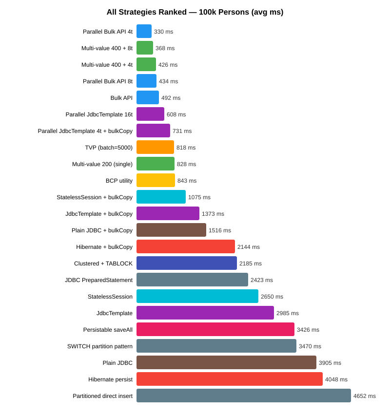
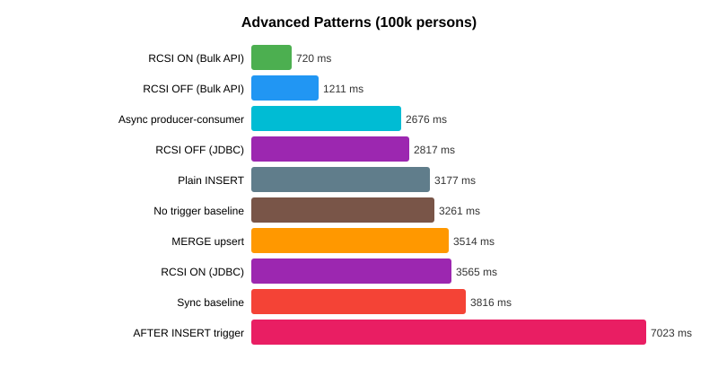

## Introduction

This final part explores two approaches that bypass Hibernate entirely:

1. **Table-Valued Parameters (TVPs)** — SQL Server's native way to pass an entire result set as a
   single parameter
2. **Plain JDBC** — bare-metal PreparedStatement batching without any ORM

## Table-Valued Parameters (TVPs)

TVPs let you send an entire table of data as a single stored procedure or query parameter. Instead of
sending N individual INSERT statements, you send one request containing all the data.

### Setup: Create the Table Type

First, create a user-defined table type in SQL Server:

```sql
CREATE TYPE dbo.PersonTableType AS TABLE (
    person_id INT,
    user_name NVARCHAR(30),
    first_name NVARCHAR(10),
    last_name NVARCHAR(15),
    years INT
);
```

### Java Implementation

The MS SQL JDBC driver provides `SQLServerDataTable` for building TVP data:

```java
@Repository
public class TvpInsertRepository {
    private final DataSource dataSource;

    public void insertWithTvp(List<Person> people, int batchSize) {
        String sql = "INSERT INTO person (person_id, user_name, first_name, last_name, years) " +
                     "SELECT person_id, user_name, first_name, last_name, years FROM ?";

        try (Connection conn = dataSource.getConnection()) {
            conn.setAutoCommit(false);

            try (CallableStatement stmt = conn.prepareCall(sql)) {
                for (int i = 0; i < people.size(); i += batchSize) {
                    int end = Math.min(i + batchSize, people.size());
                    SQLServerDataTable dataTable = buildDataTable(people.subList(i, end));
                    stmt.setObject(1, dataTable);
                    stmt.execute();
                }
                conn.commit();
            }
        }
    }

    private SQLServerDataTable buildDataTable(List<Person> people) throws SQLException {
        SQLServerDataTable dt = new SQLServerDataTable();
        dt.setTvpName("PersonTableType");
        dt.addColumnMetadata("person_id", Types.INTEGER);
        dt.addColumnMetadata("user_name", Types.NVARCHAR);
        dt.addColumnMetadata("first_name", Types.NVARCHAR);
        dt.addColumnMetadata("last_name", Types.NVARCHAR);
        dt.addColumnMetadata("years", Types.INTEGER);

        for (Person p : people) {
            dt.addRow(p.getPersonId(), p.getUserName(),
                      p.getFirstName(), p.getLastName(), p.getYears());
        }
        return dt;
    }
}
```

### TVP Advantages

- **Single round-trip per batch** — the entire data table is sent as one TDS packet
- **No 2,100-parameter limit** — unlike multi-value INSERT which hits SQL Server's max param count
- **Type-safe** — SQL Server validates the table type schema
- **Works inside transactions** — unlike `BULK INSERT` from a file

### TVP Results

| Batch Size | Avg ms |
|-----------|--------|
| 10 | 20,221 |
| 100 | 2,993 |
| 1,000 | 1,203 |
| 5,000 | 818 |

TVP at batch=5000 (818ms) is the **3rd fastest single-thread strategy** — faster than all
JDBC/Hibernate approaches, slower only than Bulk API. It's a solid middle ground.

## Plain JDBC: The Bare-Metal Baseline

How much overhead does Hibernate/JPA actually add? Let's find out with raw JDBC:

```java
@Repository
public class PlainJdbcInsertRepository {
    private final DataSource dataSource;
    private static final String INSERT_SQL =
        "INSERT INTO person (person_id, user_name, first_name, last_name, years) " +
        "VALUES (?, ?, ?, ?, ?)";

    public void insertBatch(List<Person> people, int batchSize) {
        try (Connection conn = dataSource.getConnection()) {
            conn.setAutoCommit(false);
            try (PreparedStatement ps = conn.prepareStatement(INSERT_SQL)) {
                int count = 0;
                for (Person p : people) {
                    ps.setInt(1, p.getPersonId());
                    ps.setString(2, p.getUserName());
                    ps.setString(3, p.getFirstName());
                    ps.setString(4, p.getLastName());
                    ps.setInt(5, p.getYears());
                    ps.addBatch();
                    if (++count % batchSize == 0) ps.executeBatch();
                }
                if (count % batchSize != 0) ps.executeBatch();
                conn.commit();
            }
        }
    }
}
```

### The Surprising Result

| Strategy | 100k persons (avg ms) |
|----------|----------------------|
| Plain JDBC | 3,905 |
| Hibernate persist | 4,048 |
| JdbcTemplate | 2,985 |
| StatelessSession | 2,650 |

**Plain JDBC (3,905ms) is only 3% faster than Hibernate persist (4,048ms).** The ORM overhead for
batch inserts is negligible. Most of the time is spent in JDBC driver wire protocol and SQL Server's
INSERT execution, not in Hibernate's entity management.

JdbcTemplate is actually *faster* than plain JDBC because Spring's `JdbcTemplate.batchUpdate()`
uses optimized batch parameter binding that the JDBC driver can optimize further.

### With useBulkCopyForBatchInsert=true

| Strategy | Normal | bulkCopy=true | Speedup |
|----------|--------|---------------|---------|
| Plain JDBC | 3,905 | 1,516 | 2.6x |
| JdbcTemplate | 3,089 | 1,373 | 2.3x |
| StatelessSession | 2,650 | 1,075 | 2.5x |
| Hibernate persist | 4,048 | 2,144 | 1.9x |

With `bulkCopy=true`, all JDBC-based strategies converge to similar performance. The driver's bulk
copy conversion is the dominant factor, not the Java-side abstraction.

## Important: Multi-Value INSERT + useBulkCopyForBatchInsert Incompatibility

During testing, we discovered that **multi-value INSERT** (`objectsPerInsert > 1`) is
**incompatible** with `useBulkCopyForBatchInsert=true`. When this driver flag is enabled, it
rewrites `PreparedStatement.addBatch()` calls into Bulk Copy protocol — but it expects single-row
INSERT statements with exactly `(columns)` parameters per batch entry. Multi-value INSERT SQL
(`VALUES (?,?,?),(?,?,?),(?,?,?)...`) confuses the driver because it has `(columns * N)` parameters.

This means you must choose one or the other:
- **Multi-value INSERT (400 values/statement)** — works only with `bulkCopy=false`
- **useBulkCopyForBatchInsert=true** — works only with single-row INSERT statements

Both are excellent optimizations, but they cannot be combined.



## Final Rankings: All Strategies Combined

| Rank | Strategy | 100k avg ms | Part | Notes |
|------|----------|-------------|------|-------|
| 1 | Parallel Bulk API 4t | **330** | 6 | Fastest overall |
| 2 | Multi-value 400 + 8 threads | 368 | 3+6 | No bulkCopy needed |
| 3 | Multi-value 400 + 4 threads | 426 | 3+6 | No bulkCopy needed |
| 4 | Parallel Bulk API 8t | 434 | 6 | Diminishing returns |
| 5 | Bulk API | 492 | 2 | Fastest single-thread |
| 6 | Parallel Bulk API 4t + bulkCopy | 603 | 6+4 | bulkCopy on bulk API is redundant |
| 7 | Parallel JdbcTemplate 16t | 608 | 6 | JdbcTemplate benefits most from threads |
| 8 | Parallel JdbcTemplate 4t + bulkCopy | 731 | 6+4 | |
| 9 | TVP (batch=5000) | 818 | 8 | Best portable single-thread |
| 10 | Multi-value 400 single thread | 1,058 | 3 | No bulkCopy, no threads |
| 11 | StatelessSession + bulkCopy | 1,075 | 5+4 | Best Hibernate option |
| 12 | JdbcTemplate + bulkCopy | 1,373 | 4 | |
| 13 | Plain JDBC + bulkCopy | 1,516 | 8+4 | |
| 14 | Hibernate + bulkCopy | 2,144 | 4 | |
| 15 | JDBC PreparedStatement | 2,423 | 2 | |
| 16 | StatelessSession | 2,650 | 5 | |
| 17 | JdbcTemplate | 2,985 | 2 | |
| 18 | Persistable saveAll | 3,426 | 5 | |
| 19 | Plain JDBC | 3,905 | 8 | |
| 20 | Hibernate persist | 4,048 | 1 | |
| 21 | saveAll (original) | 27,794 | 1 | SELECT per entity |

## Advanced Patterns: RCSI, MERGE, Triggers, Async

### Snapshot isolation (READ_COMMITTED_SNAPSHOT)

RCSI changes `READ_COMMITTED` to use row versioning instead of shared locks for reads. It prevents
reader-writer blocking at the cost of version store overhead:

| Strategy | RCSI OFF | RCSI ON | Delta |
|----------|----------|---------|-------|
| Bulk API | 1,211 | **720** | **40% faster** |
| JdbcTemplate | 2,817 | 3,565 | 27% slower |

**Surprise:** RCSI dramatically helps Bulk API (fewer latches/lock contention on data pages) but
hurts JdbcTemplate (row versioning writes to tempdb). Enable RCSI if you're bulk-loading with the
Bulk Copy protocol and have concurrent readers.

### MERGE vs plain INSERT

`MERGE INTO ... USING (VALUES) WHEN MATCHED THEN UPDATE WHEN NOT MATCHED THEN INSERT` is the
canonical SQL upsert. How much does the upsert semantics cost?

| Method | 100k rows (avg ms) |
|--------|-------------------|
| Plain INSERT | 3,177 |
| MERGE upsert | 3,514 (+11%) |

The 11% overhead is the cost of the ON clause evaluation and the branching logic. For pure inserts,
use INSERT. For true upserts (where some rows may already exist), MERGE is cleaner than a
SELECT-then-INSERT/UPDATE pattern.

**Warning:** MERGE has known bugs with concurrent executions on SQL Server. Many SQL Server MVPs
recommend `INSERT ... ON EXISTING UPDATE` or explicit `IF EXISTS` patterns in production code.

### Trigger overhead

A single `AFTER INSERT` trigger that writes one audit row per insertion:

```sql
CREATE TRIGGER tr_person_trigger_insert ON person_trigger
AFTER INSERT AS
BEGIN
    SET NOCOUNT ON;
    INSERT INTO person_audit (person_id, action)
    SELECT person_id, 'INSERT' FROM inserted;
END
```

| Scenario | 100k rows (avg ms) |
|----------|-------------------|
| No trigger | 3,261 |
| With AFTER INSERT trigger | **7,023 (2.2x slower)** |

**Triggers are expensive.** Each INSERT batch now does double the work — one for the base table,
one for the audit table. Consider:
- Logging via application code instead of triggers (gives you batching and backpressure control)
- Change Data Capture (CDC) — SQL Server reads the transaction log async
- Temporal tables (built-in system-versioned history)

### Async producer-consumer pipeline

The sync baseline does CPU work (generating data) and I/O work (inserting) sequentially. A
producer-consumer pipeline overlaps them:

```java
BlockingQueue<List<Person>> queue = new ArrayBlockingQueue<>(4);
// Producer: generates batches of 1000, puts to queue
// Consumer: polls queue, inserts batch
```

| Pattern | 100k rows (avg ms) |
|---------|-------------------|
| Sync baseline (CPU then I/O) | 3,816 |
| **Async producer-consumer** | **2,676 (30% faster)** |

A single-producer, single-consumer pipeline is enough to overlap work. More consumers would help
only if the DB can accept more concurrent writers (see [Part 6](/post/java/mssqlserver/fast_insert_part6/)).



## Key Takeaways from the Series

1. **Parallel Bulk API** is the overall winner (330ms for 100k rows). The Bulk Copy API already uses
   an optimized protocol; splitting across threads adds connection-level parallelism.

2. **Multi-value INSERT + parallel threads** (368ms) is a close second and **doesn't require
   `useBulkCopyForBatchInsert`** or the Bulk Copy API — it works with any JDBC driver.

3. **`useBulkCopyForBatchInsert=true`** gives 2-2.5x speedup to single-row batch strategies. One
   connection string parameter is the easiest win. But it's incompatible with multi-value INSERT.

4. **Hibernate's overhead is ~3%** for batch inserts. The ORM is not the bottleneck; the network
   and database engine are.

5. **Parallelism helps 2-7x** depending on the strategy and thread count. 4 threads is the safe
   default; 8-16 helps JdbcTemplate more than Bulk API.

6. **Indexes are the hidden cost** — 5 non-clustered indexes make inserts 6-7x slower regardless
   of strategy. Drop and rebuild indexes for bulk loads.

7. **TVPs are underrated** — 3rd fastest single-thread strategy with a clean API, no parameter
   count limits, and works inside transactions.

8. **Batch size sweet spot is 500-1000** for most strategies. Below 200, overhead dominates; above
   1000, diminishing returns.

9. **Multi-value objectsPerInsert sweet spot is 200** — beyond that, SQL parser overhead increases
   faster than network savings decrease.

10. **Compression hurts inserts** — ROW (+7%) and PAGE (+33%) compression add CPU overhead that
    outweighs I/O savings for writes. Save compression for read-heavy tables.

11. **BCP (843ms) is slower than Java Bulk API (691ms)** for in-memory data — file I/O is the
    bottleneck, not the protocol.

12. **Concurrent readers slow inserts 2.5x** — use TABLOCK for dedicated bulk-load windows to
    prevent reader contention.

13. **Columnstore tables are 3.5x slower** for OLTP-style inserts — the delta store overhead only
    pays off at analytical query time.

14. **Auto-commit per row is 15x slower** than batched transactions — never do it.

15. **Isolation level and GC choice don't matter** for INSERT-only workloads. Default
    READ_COMMITTED + default G1 are fine; tuning them is wasted effort.

16. **Fill factor 100 is best for sequential IDs**. Lower fill factors (70-80) only help with
    random-key inserts that cause page splits.

17. **SWITCH PARTITION is the gold standard** for zero-downtime bulk loads — load a staging
    heap, then atomically metadata-swap it into a partition (milliseconds, regardless of size).

18. **RCSI (snapshot isolation) is a Bulk API accelerator**. Enable it if you use Bulk API and
    have concurrent readers — 40% faster. But it slows JDBC batches 27% due to version store
    overhead; don't enable it blindly.

19. **MERGE costs 11% over plain INSERT** for upsert semantics. Use INSERT for pure appends.

20. **AFTER INSERT triggers are 2.2x slower**. Prefer application logging, CDC, or temporal
    tables for audit trails.

21. **Async producer-consumer is 30% faster** than sync by overlapping CPU and I/O work. Even
    one producer + one consumer is enough.

22. **Random GUID clustered keys cost 19% minimum** on empty tables, far more on populated ones
    (page splits). Use `NEWSEQUENTIALID()` or an ordered GUID (UUIDv7/ULID) if you must use GUIDs.

23. **Change Tracking is expensive (62% overhead)**. Enable only if a downstream consumer actually
    reads the change feed. Full CDC (Enterprise only) is even more expensive.

24. **Temporal tables are cheap for audit (+31%)** — far better than AFTER INSERT triggers
    (+120%). The right answer for most point-in-time history requirements.

25. **Filtered indexes are 60% cheaper than full indexes** on the same column. If your queries
    only need a subset of rows, index only that subset.

26. **INCLUDE is 30% cheaper than composite** — storing columns only at the leaf level is cheaper
    than making them part of the sort key.

27. **Computed columns are essentially free** on insert (persisted +0%, non-persisted +0%). Use
    them for derived values; they're cleaner than app-side computations and support indexing.

28. **Delayed Durability can make bulk inserts SLOWER (+49%)** — it's a per-transaction
    optimization for many small commits, not for single large transactions.

29. **Trace flag 610 doesn't help regular INSERTs** — only `BULK INSERT`, `BCP`, and
    `INSERT ... SELECT` benefit. The JDBC Bulk Copy API already handles this transparently.

The full benchmark code is available in the
[blog-examples](https://github.com/mmarko88/blog-examples/tree/main/fastest-insert) repository.
