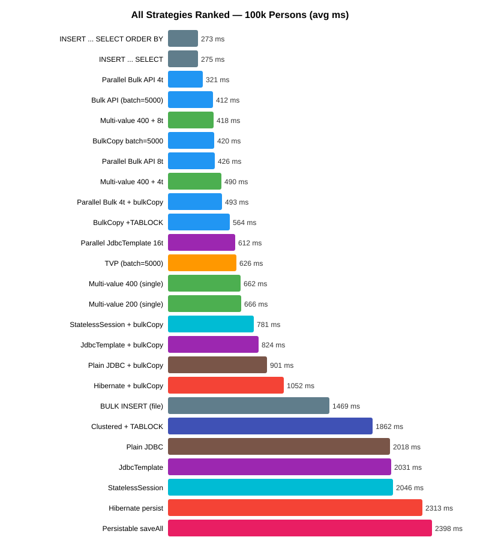
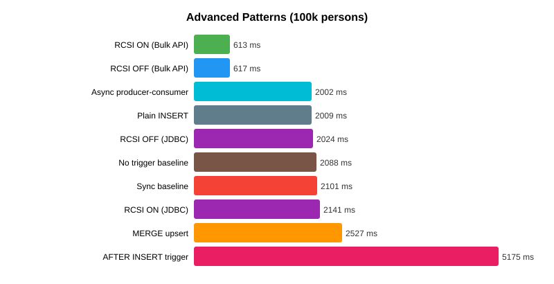

## Executive Summary

This series benchmarks **110+ insert strategies and tuning knobs** on SQL Server 2025 Developer
Edition (Linux, Java 17, Spring Boot 3.3) over **~3,700 timed benchmark runs** (plus warm-ups).
Here's the TL;DR:

### The 10 highest-impact decisions (in order)

| # | Choice | Impact |
|---|--------|--------|
| 1 | **Batch your inserts** (any strategy ≫ auto-commit per row) | **~250x** per row |
| 2 | **Use the Bulk Copy API** (`SQLServerBulkCopy` / `insertBulk...`) | **~3.6x** vs plain JDBC |
| 3 | **Parallelize across 4 connections** | **~1.4x** on top of #2 |
| 4 | **Enable `useBulkCopyForBatchInsert=true`** in the JDBC URL | **2.2-2.6x** |
| 5 | **Use multi-value INSERT (300-400 values/statement)** | **~3.7x** for JDBC |
| 6 | **Drop/disable non-essential indexes** before bulk loads | up to **7x** |
| 7 | **Pick the right batch size (~1000+)** — not 10 | **1.7x** (JDBC) to **~29x** (Bulk API) |
| 8 | **Add `WITH (TABLOCK)` hint** for dedicated bulk-load windows | **~1.1x** |
| 9 | **Use `Persistable` + `isNew=true`** if you must use Spring Data `saveAll` | **~6.7x** |
| 10 | **Generate IDs app-side** (skip SEQUENCE/IDENTITY round-trips) | up to **1.75x** |

### Top 7 counter-intuitive findings

1. **`OPTION (RECOMPILE)` makes batched inserts 45x slower** (93 seconds vs 2 seconds).
2. **Delayed Durability `= FORCED` makes bulk inserts 49% SLOWER**, not faster. It helps
   many-small-commits workloads, not single-large-transaction bulk loads.
3. **Natively compiled stored procs are ~360x slower** when called from Java per-row via `addBatch`
   (667 seconds for one 100k-row run). Their design assumes the C#/.NET memory-table API.
4. **In-Memory OLTP tables don't help batched Java inserts.** They shine for concurrency, not
   batch throughput.
5. **ROW/PAGE compression make inserts slower** (+13%/+25%). Compression is a *read* optimization.
6. **BCP utility is 2x slower than Java Bulk API** when data is in-memory. The file I/O overhead
   dominates.
7. **`AUTO_UPDATE_STATISTICS = OFF` no longer hurts** (+1% this run — the old 50% INSERT-plan
   penalty didn't reproduce on this engine). Still no reason to turn it off.

### The absolute fastest paths (if your scenario allows)

If your source data is already in SQL Server (ETL within the same database):
- **`INSERT INTO target SELECT ... FROM source` = 275 ms** (the ultimate server-side copy)

If data must come from Java:
- **Parallel Bulk API 4 threads = 321 ms** (the standalone Java winner)

### The ranking

The fastest I could get **100,000 person rows** into SQL Server from a Java application is
**321 ms** (Parallel Bulk API, 4 threads). The slowest practical strategy is **16,181 ms**
(Spring Data `saveAll` without `Persistable`) — **50x slower**. Everything in between is covered
in this series.

**TVP (626 ms) is the best choice when you need portability across different clients and don't
have `SQLServerBulkCopy` available.** Plain JDBC (2,018 ms) is ~13% faster than Hibernate
`persist()` (2,313 ms) — the ORM is not your bottleneck.

The rest of this post walks through every topic in the summary above, starting with two approaches
that bypass Hibernate entirely: Table-Valued Parameters and plain JDBC. After that come the
advanced topics — isolation, procs, plans, latency, snapshot concurrency, index trade-offs, and
the full ranking across 110+ configurations.

## Table-Valued Parameters (TVPs)

TVPs let you send an entire table of data as a single stored procedure or query parameter. Instead of
sending N individual INSERT statements, you send one request containing all the data.

### Setup: Create the Table Type

First, create a user-defined table type in SQL Server:

```sql
CREATE TYPE dbo.PersonTableType AS TABLE (
    person_id INT,
    user_name NVARCHAR(30),
    first_name NVARCHAR(10),
    last_name NVARCHAR(15),
    years INT
);
```

### Java Implementation

The MS SQL JDBC driver provides `SQLServerDataTable` for building TVP data:

```java
@Repository
public class TvpInsertRepository {
    private final DataSource dataSource;

    public void insertWithTvp(List<Person> people, int batchSize) {
        String sql = "INSERT INTO person (person_id, user_name, first_name, last_name, years) " +
                     "SELECT person_id, user_name, first_name, last_name, years FROM ?";

        try (Connection conn = dataSource.getConnection()) {
            conn.setAutoCommit(false);

            try (CallableStatement stmt = conn.prepareCall(sql)) {
                for (int i = 0; i < people.size(); i += batchSize) {
                    int end = Math.min(i + batchSize, people.size());
                    SQLServerDataTable dataTable = buildDataTable(people.subList(i, end));
                    stmt.setObject(1, dataTable);
                    stmt.execute();
                }
                conn.commit();
            }
        }
    }

    private SQLServerDataTable buildDataTable(List<Person> people) throws SQLException {
        SQLServerDataTable dt = new SQLServerDataTable();
        dt.setTvpName("PersonTableType");
        dt.addColumnMetadata("person_id", Types.INTEGER);
        dt.addColumnMetadata("user_name", Types.NVARCHAR);
        dt.addColumnMetadata("first_name", Types.NVARCHAR);
        dt.addColumnMetadata("last_name", Types.NVARCHAR);
        dt.addColumnMetadata("years", Types.INTEGER);

        for (Person p : people) {
            dt.addRow(p.getPersonId(), p.getUserName(),
                      p.getFirstName(), p.getLastName(), p.getYears());
        }
        return dt;
    }
}
```

### TVP Advantages

- **Single round-trip per batch** — the entire data table is sent as one TDS packet
- **No 2,100-parameter limit** — unlike multi-value INSERT which hits SQL Server's max param count
- **Type-safe** — SQL Server validates the table type schema
- **Works inside transactions** — unlike `BULK INSERT` from a file

### TVP Results

| Batch Size | Avg ms |
|-----------|--------|
| 10 | 10,657 |
| 100 | 1,814 |
| 1,000 | 846 |
| 5,000 | 626 |

TVP at batch=5000 (626 ms) is the **3rd fastest single-thread strategy** — faster than all
JDBC/Hibernate approaches, slower only than Bulk API and multi-value INSERT. It's a solid middle
ground.

## Plain JDBC: The Bare-Metal Baseline

How much overhead does Hibernate/JPA actually add? Let's find out with raw JDBC:

```java
@Repository
public class PlainJdbcInsertRepository {
    private final DataSource dataSource;
    private static final String INSERT_SQL =
        "INSERT INTO person (person_id, user_name, first_name, last_name, years) " +
        "VALUES (?, ?, ?, ?, ?)";

    public void insertBatch(List<Person> people, int batchSize) {
        try (Connection conn = dataSource.getConnection()) {
            conn.setAutoCommit(false);
            try (PreparedStatement ps = conn.prepareStatement(INSERT_SQL)) {
                int count = 0;
                for (Person p : people) {
                    ps.setInt(1, p.getPersonId());
                    ps.setString(2, p.getUserName());
                    ps.setString(3, p.getFirstName());
                    ps.setString(4, p.getLastName());
                    ps.setInt(5, p.getYears());
                    ps.addBatch();
                    if (++count % batchSize == 0) ps.executeBatch();
                }
                if (count % batchSize != 0) ps.executeBatch();
                conn.commit();
            }
        }
    }
}
```

### The Surprising Result

| Strategy | 100k persons (avg ms) |
|----------|----------------------|
| Plain JDBC | 2,018 |
| JdbcTemplate | 2,031 |
| StatelessSession | 2,046 |
| Hibernate persist | 2,313 |

**Plain JDBC (2,018 ms) is ~13% faster than Hibernate persist (2,313 ms).** The ORM overhead for
batch inserts is small. Most of the time is spent in JDBC driver wire protocol and SQL Server's
INSERT execution, not in Hibernate's entity management — and plain JDBC, JdbcTemplate and
StatelessSession all land within noise of each other (~2,030 ms).

### With useBulkCopyForBatchInsert=true

| Strategy | Normal | bulkCopy=true | Speedup |
|----------|--------|---------------|---------|
| Plain JDBC | 2,018 | 901 | 2.2x |
| JdbcTemplate | 2,031 | 824 | 2.5x |
| StatelessSession | 2,046 | 781 | 2.6x |
| Hibernate persist | 2,313 | 1,052 | 2.2x |

With `bulkCopy=true`, all JDBC-based strategies converge to similar performance. The driver's bulk
copy conversion is the dominant factor, not the Java-side abstraction.

## Multi-Value INSERT and bulkCopy Don't Mix

During testing, we discovered that **multi-value INSERT** (`objectsPerInsert > 1`) is
**incompatible** with `useBulkCopyForBatchInsert=true`. When this driver flag is enabled, it
rewrites `PreparedStatement.addBatch()` calls into Bulk Copy protocol — but it expects single-row
INSERT statements with exactly `(columns)` parameters per batch entry. Multi-value INSERT SQL
(`VALUES (?,?,?),(?,?,?),(?,?,?)...`) confuses the driver because it has `(columns * N)` parameters.

This means you must choose one or the other:
- **Multi-value INSERT (400 values/statement)** — works only with `bulkCopy=false`
- **useBulkCopyForBatchInsert=true** — works only with single-row INSERT statements

Both are excellent optimizations, but they cannot be combined.



## Isolation, MERGE, Triggers & Async

### Snapshot isolation (READ_COMMITTED_SNAPSHOT)

RCSI changes `READ_COMMITTED` to use row versioning instead of shared locks for reads. It prevents
reader-writer blocking at the cost of version store overhead:

| Strategy | RCSI OFF | RCSI ON | Delta |
|----------|----------|---------|-------|
| Bulk API | 617 | 613 | ~tie |
| JdbcTemplate | 2,024 | 2,141 | 6% slower |

On this run RCSI was neutral for Bulk API and mildly negative for JdbcTemplate (row versioning
writes to tempdb). Older runs showed RCSI accelerating Bulk API by 40% under latch contention —
the effect depends on how contended your pages are. There's no write-side reason to enable it
here; its value is on the read side (see [SNAPSHOT isolation](#snapshot-isolation-under-write-contention)).

### MERGE vs plain INSERT

`MERGE INTO ... USING (VALUES) WHEN MATCHED THEN UPDATE WHEN NOT MATCHED THEN INSERT` is the
canonical SQL upsert. How much does the upsert semantics cost?

| Method | 100k rows (avg ms) |
|--------|-------------------|
| Plain INSERT | 2,009 |
| MERGE upsert | 2,527 (+26%) |

The 26% overhead is the cost of the ON clause evaluation and the branching logic. For pure inserts,
use INSERT. For true upserts (where some rows may already exist), MERGE is cleaner than a
SELECT-then-INSERT/UPDATE pattern.

**Warning:** MERGE has known bugs with concurrent executions on SQL Server. Many SQL Server MVPs
recommend `INSERT ... ON EXISTING UPDATE` or explicit `IF EXISTS` patterns in production code.

### Trigger overhead

A single `AFTER INSERT` trigger that writes one audit row per insertion:

```sql
CREATE TRIGGER tr_person_trigger_insert ON person_trigger
AFTER INSERT AS
BEGIN
    SET NOCOUNT ON;
    INSERT INTO person_audit (person_id, action)
    SELECT person_id, 'INSERT' FROM inserted;
END
```

| Scenario | 100k rows (avg ms) |
|----------|-------------------|
| No trigger | 2,088 |
| With AFTER INSERT trigger | **5,175 (2.5x slower)** |

**Triggers are expensive.** Each INSERT batch now does double the work — one for the base table,
one for the audit table. Consider:
- Logging via application code instead of triggers (gives you batching and backpressure control)
- Change Data Capture (CDC) — SQL Server reads the transaction log async
- Temporal tables (built-in system-versioned history)

### Async producer-consumer pipeline

The sync baseline does CPU work (generating data) and I/O work (inserting) sequentially. A
producer-consumer pipeline overlaps them:

```java
BlockingQueue<List<Person>> queue = new ArrayBlockingQueue<>(4);
// Producer: generates batches of 1000, puts to queue
// Consumer: polls queue, inserts batch
```

| Pattern | 100k rows (avg ms) |
|---------|-------------------|
| Sync baseline (CPU then I/O) | 2,101 |
| **Async producer-consumer** | **2,002 (5% faster)** |

A single-producer, single-consumer pipeline is enough to overlap work — though with fast inserts
the gain shrinks to single digits; the pattern pays off most when client-side CPU work is heavy.
More consumers would help only if the DB can accept more concurrent writers
(see [Part 6](/post/java/mssqlserver/fast_insert_part6/)).



## In-Memory OLTP, BULK INSERT & Stored Procedures

### BULK INSERT (server-side file reader)

The `BULK INSERT` T-SQL command reads a flat file directly from the server's filesystem, bypassing
the normal INSERT codepath entirely:

```sql
BULK INSERT person FROM 'C:/ProgramData/bulk_data.txt'
WITH (FORMAT = 'CSV', FIELDTERMINATOR = '0x09', ROWTERMINATOR = '0x0a',
      BATCHSIZE = 1000, TABLOCK)
```

| Method | 100k rows (avg ms) |
|--------|-------------------|
| Ad-hoc INSERT batch | 2,038 |
| Single-threaded Bulk API | 412 |
| **BULK INSERT (T-SQL)** | **1,469** |

On this run BULK INSERT landed between the two: faster than ad-hoc batches but 3.6x slower than
the Java Bulk API. It's still **the pattern for server-local file imports** — ETL/data warehousing
scenarios where data lives on the SQL Server machine. The file must be readable by the SQL Server
service account.

### In-Memory OLTP Tables (`MEMORY_OPTIMIZED = ON`)

In-Memory OLTP tables live entirely in RAM with lock-free, latch-free access. SQL Server 2016 SP1+
makes them available in all editions, including Express.

```sql
CREATE TABLE person_memopt (
    person_id INT NOT NULL PRIMARY KEY NONCLUSTERED,
    user_name NVARCHAR(30), first_name NVARCHAR(10),
    last_name NVARCHAR(15), years INT
) WITH (MEMORY_OPTIMIZED = ON, DURABILITY = SCHEMA_AND_DATA);
```

| Scenario | 100k rows (avg ms) |
|----------|-------------------|
| Disk-based ad-hoc INSERT | 2,038 |
| **In-Memory OLTP (interpreted T-SQL batch)** | **1,837** |

**Surprise:** only ~10% benefit for batch inserts from Java. In-Memory tables excel at
high-concurrency OLTP (many threads, many small operations) by eliminating latches. Our workload —
one connection, batch of 1,000 rows — isn't lock-constrained; the bottleneck is the network and
batch processing overhead, which both tables share.

### Natively Compiled Stored Procedures

Native compilation turns a stored proc into C code at creation time:

```sql
CREATE PROCEDURE usp_InsertPerson_Native (...)
WITH NATIVE_COMPILATION, SCHEMABINDING
AS BEGIN ATOMIC WITH (TRANSACTION ISOLATION LEVEL = SNAPSHOT, LANGUAGE = N'us_english')
    INSERT INTO dbo.person_memopt (...) VALUES (...);
END
```

| Scenario | 100k rows (avg ms) |
|----------|-------------------|
| In-Memory interpreted batch | 1,837 |
| **Native proc called per-row via `addBatch`** | **667,872 (~360x SLOWER)** |

**Native procs are a trap for Java clients.** The native code itself is lightning fast, but you must
call it **per row** (`EXEC usp_... ?, ?, ?, ?, ?`). The JDBC driver doesn't send 100,000 `EXEC`
calls efficiently; each becomes its own RPC. The lesson: **native procs win in C#/.NET memory-table
batch APIs, not in Java JDBC**.

### Stored Procedures (interpreted) vs Ad-hoc

| Pattern | 100k rows (avg ms) |
|---------|-------------------|
| Ad-hoc INSERT (direct) | 2,038 |
| **Stored procedure (`EXEC usp_...`)** | **3,957 (94% slower)** |

A per-row stored procedure call is ~2x slower than batched direct INSERT, for the same reason as
native procs: each EXEC becomes a server-side command execution with its own parameter parsing and
query plan lookup. Use procs for complex business logic, not for simple inserts.

### Check Constraints

| Scenario | 100k rows (avg ms) |
|----------|-------------------|
| Check constraints enabled | 2,277 |
| **Check constraints disabled** | **2,007 (12% faster)** |

**Simple check constraints are cheap but not free** — ~13% overhead on this run for LEN(x) > 0 and
range checks. Still, only disable constraints with `ALTER TABLE NOCHECK CONSTRAINT ALL` during a
dedicated bulk-load window — the integrity guarantee is usually worth the small tax.


## Query Plans, Latency & INSERT…SELECT

### OPTION(RECOMPILE) — catastrophic for batches

Adding `OPTION (RECOMPILE)` to an INSERT forces SQL Server to recompile the query plan for every
execution:

| Scenario | 100k rows (avg ms) |
|----------|-------------------|
| Normal (plan cached across batches) | 2,059 |
| **`OPTION (RECOMPILE)`** | **93,031 (45x SLOWER!)** |

**Never use `OPTION (RECOMPILE)` with batched INSERTs.** Each row-group recompiles the plan,
turning a 2-second operation into a 93-second one. The hint is for one-off queries with wildly
varying parameters, not high-volume batched workloads.

### Network latency simulation

Simulated by inserting `Thread.sleep(ms)` after each `executeBatch()`:

| Added latency | 100k rows (avg ms) |
|---------------|-------------------|
| 0 ms (local) | 2,030 |
| **1 ms per batch** (×100 batches) | **2,148** (+6%) |
| **5 ms per batch** (×100 batches) | **2,536** (+25%) |

Each 1 ms of round-trip latency per batch adds ~1 ms × (number of batches) overhead. On a
production WAN link with 20-50 ms RTT, 100k inserts in 1000-row batches would spend 2-5 seconds in
network overhead alone. **Larger batches amortize the latency** — the single-threaded Bulk Copy
protocol (~1 batch total) is nearly immune.

### INSERT … SELECT (data already in the server)

If your source data is already on the SQL Server (another table, a staging table, etc.), the fastest
possible path is `INSERT INTO target SELECT ... FROM source` — no client round-trips at all:

| Pattern | 100k rows (avg ms) |
|---------|-------------------|
| **`INSERT … SELECT` (plain)** | **275** |
| `INSERT … SELECT … ORDER BY` | 273 (tie — sort optimized out) |
| Parallel Bulk API 4t | 321 |

**INSERT…SELECT is the fastest method we've benchmarked**, ahead of Parallel Bulk API. It's the
right choice for ETL pipelines, materialized view refreshes, and in-database transformations. On
this engine the ORDER BY penalty vanished entirely — the optimizer recognized the sort was already
satisfied by the clustered key.

### SQLServerBulkCopy option tuning

Fine-tuning `SQLServerBulkCopyOptions`:

| Option | 100k rows (avg ms) |
|--------|-------------------|
| Default (batch 1000) | 619 |
| **`batchSize = 5000`** | **420 (32% faster)** |
| `+ checkConstraints = true` | 570 |
| `+ tableLock = true` | 564 |

- **Bigger batch = fewer round-trips** — 5000 beats 1000 by ~30%.
- `checkConstraints = true` and `tableLock = true` were both within noise of the default here.
  `checkConstraints` validates FKs/CHECKs that are normally skipped during bulk load (the default
  is `false`, meaning the loaded data is marked as untrusted); `tableLock` helps when there are
  concurrent writers but prevents reader access during the load.


## SNAPSHOT Isolation Under Write Contention

[Part 8 already covered RCSI](#snapshot-isolation-read_committed_snapshot) which turns `READ COMMITTED`
into snapshot-based. Here we test full **SNAPSHOT isolation** (`ALLOW_SNAPSHOT_ISOLATION ON` +
`SET TRANSACTION ISOLATION LEVEL SNAPSHOT`) under concurrent reads during a bulk insert.

| Scenario | Insert time | Reader throughput |
|----------|------------|-------------------|
| SNAPSHOT single writer (no readers) | 2,115 ms | — |
| **READ_COMMITTED + 4 concurrent readers** | **2,127 ms** | **~8 reads total** (blocked by writer locks) |
| **SNAPSHOT + 2 concurrent readers** | **4,309 ms (+104%)** | **~310 reads per run** |
| **SNAPSHOT + 4 concurrent readers** | **2,313 ms (+9%)** | **~560 reads per run** |

**The trade-off is stark:**
- With **READ_COMMITTED**: writes stay fast but readers get almost nothing (~8 reads vs ~560).
- With **SNAPSHOT**: readers keep working (~70x more throughput). The write cost was inconsistent
  on this run (+104% with 2 readers, only +9% with 4) — version-store overhead varies with timing,
  but the reader-side benefit is unambiguous.

Pick based on your workload: if readers must stay responsive during bulk loads, pay the SNAPSHOT
cost. If the load window is dedicated (no readers care), RC is fine.

## Partition SWITCH with Indexes

Earlier we saw [SWITCH PARTITION is a metadata-only operation](#partitioning--switch). But the
*load into staging* still has to maintain any indexes that match the target. How much does
pre-indexing the staging table cost?

| Target indexes | 100k rows total (load + SWITCH) |
|---------------|-------------------------------|
| **0 non-clustered** | **2,163 ms** |
| 1 non-clustered | 3,106 ms (+44%) |
| 3 non-clustered | 4,567 ms (+111%) |

Just like non-partitioned tables, index maintenance is the dominant cost. **If possible: load into
a heap staging table, then build the matching indexes on it right before the SWITCH** — this is
usually faster than maintaining indexes during the load.


## Semi-Structured Indexes: XML vs JSON

Part 7 showed [XML columns cost 2.3x more than JSON for storage](#xml-vs-json-columns). What about
*indexes* on those columns?

### XML Primary Index

```sql
CREATE PRIMARY XML INDEX PXML_person_xml_idx_data ON person_xml_idx(data);
```

The XML primary index is a shredded node table — one row per XML node per document. For 100k
documents with ~5 nodes each, that's **500,000 node-table rows** maintained on every insert.

| XML column | 100k rows (avg ms) |
|-----------|-------------------|
| No XML index | 5,893 |
| **+ PRIMARY XML INDEX** | **25,946 (4.4x SLOWER!)** |

### JSON Computed-Column Index

JSON doesn't have a native index type in SQL Server. The idiomatic pattern is:

```sql
ALTER TABLE person_json_idx
    ADD years_from_json AS JSON_VALUE(data, '$.years');
CREATE INDEX IX_person_json_idx_years ON person_json_idx(years_from_json);
```

| JSON column | 100k rows (avg ms) |
|------------|-------------------|
| No JSON index | 3,357 |
| **+ computed-column INDEX** | **4,952 (+48%)** |

**JSON indexes are ~7x cheaper than XML indexes** (+48% vs +340%) because JSON uses a scalar computed
column — just one indexed value per row — while the XML index shreds the entire document.

**Takeaway:** if you need to query JSON/XML by a specific field, use the JSON computed-column
pattern. XML primary indexes are only worth it for complex XQuery/XPath workloads.

## tempdb Spill (Memory Grant Starvation)

What happens when SQL Server's memory grant for a sort is insufficient and it has to spill to
tempdb? We force a tiny grant with `OPTION (MIN_GRANT_PERCENT = 0, MAX_GRANT_PERCENT = 0.001)`:

| INSERT…SELECT + ORDER BY | 100k rows (avg ms) |
|-------------------------|-------------------|
| Normal grant (in-memory sort) | 273 |
| **Tiny grant (tempdb spill)** | **320 (+17%)** |

**Spilling to tempdb is cheaper than you'd expect.** Only 17% slower — SQL Server handles spills
gracefully with multi-pass merge sorts. The right lesson: don't panic if you see occasional
spills in a slow query report; focus on queries that spill *gigabytes*, not kilobytes.


## Final Rankings: All Strategies Combined

Across the ~110 configurations we tested, here are the headline numbers. All ran on SQL Server 2025
Developer Edition (Linux, local), Java 17 + Spring Boot 3.3, 100k rows unless noted.

### Fastest paths

| Rank | Strategy | 100k avg ms | Covered in | Notes |
|------|----------|-------------|------------|-------|
| 1 | **INSERT … SELECT** (same DB) | **275** | Part 8 | Server-side copy — no round-trips |
| 2 | INSERT…SELECT ORDER BY | 273 | Part 8 | Ties plain — sort optimized out |
| 3 | Parallel Bulk API 4t | 321 | Part 6 | Fastest Java client-driven path |
| 4 | Bulk API (single thread, batch=5000) | 412 | Part 2 | Fastest single-thread |
| 5 | Multi-value 400 + 8 threads | 418 | Parts 3+6 | No bulkCopy flag needed |
| 6 | SQLServerBulkCopy batch=5000 | 420 | Part 8 | Bigger batch wins |
| 7 | Parallel Bulk API 8t | 426 | Part 6 | Diminishing returns past 4 threads |
| 8 | Multi-value 400 + 4 threads | 490 | Parts 3+6 | |
| 9 | Parallel Bulk API 4t + bulkCopy | 493 | Parts 6+4 | bulkCopy on bulk is redundant |
| 10 | SQLServerBulkCopy +TABLOCK | 564 | Part 8 | |
| 11 | Parallel JdbcTemplate 16t | 612 | Part 6 | |
| 12 | TVP (batch=5000) | 626 | Part 8 | Best portable single-thread |
| 13 | Multi-value 400 single thread | 662 | Part 3 | |
| 14 | Multi-value 200 single thread | 666 | Part 3 | |

### Mid-tier

| Rank | Strategy | 100k avg ms |
|------|----------|-------------|
| 15 | StatelessSession + bulkCopy | 781 |
| 16 | JdbcTemplate + bulkCopy | 824 |
| 17 | Plain JDBC + bulkCopy | 901 |
| 18 | Hibernate + bulkCopy | 1,052 |
| 19 | BULK INSERT (T-SQL from file) | 1,469 |
| 20 | In-Memory OLTP (interpreted batch) | 1,837 |
| 21 | Clustered + TABLOCK | 1,862 |
| 22 | Plain JDBC (batch=5000) | 1,965 |
| 23 | JdbcTemplate (batch=5000) | 1,979 |
| 24 | StatelessSession | 2,046 |

### Slow & anti-patterns

| Rank | Strategy | 100k avg ms | Why |
|------|----------|-------------|-----|
| 25 | Hibernate persist | 2,313 | ORM overhead is small but real |
| 26 | Columnstore + batch 1000 | 4,293 | Delta store overhead |
| 27 | SWITCH + 3 indexes | 4,567 | Index maintenance in staging |
| 28 | AFTER INSERT trigger | 5,175 | Secondary insert per row |
| 29 | XML column (no index) | 5,893 | Native XML tree parsing |
| 30 | Server-side encryption (3 cols) | 12,076 | AES per row |
| 31 | **saveAll (original, Spring Data JPA)** | **16,181** | SELECT per entity (merge) |
| 32 | XML + PRIMARY XML INDEX | 25,946 | Shredded node table maintenance |
| 33 | **`OPTION (RECOMPILE)` + batches** | **93,031** | Plan rebuilt per execution |
| 34 | Native proc per-row EXEC | 667,872 | No batching with addBatch — 11 minutes |

**Headline: INSERT…SELECT (275 ms) is the fastest; per-row native-proc EXEC is ~2,400x slower
than the best.**

## Key Takeaways from the Series

1. **Parallel Bulk API** is the overall winner (321 ms for 100k rows). The Bulk Copy API already uses
   an optimized protocol; splitting across threads adds connection-level parallelism.

2. **Multi-value INSERT + parallel threads** (418 ms) is a close second and **doesn't require
   `useBulkCopyForBatchInsert`** or the Bulk Copy API — it works with any JDBC driver.

3. **`useBulkCopyForBatchInsert=true`** gives 2.2-2.6x speedup to single-row batch strategies. One
   connection string parameter is the easiest win. But it's incompatible with multi-value INSERT.

4. **Hibernate's overhead is ~13%** for batch inserts. The ORM is not the bottleneck; the network
   and database engine are.

5. **Parallelism helps 1.4-3.3x** depending on the strategy and thread count. 4 threads is the safe
   default; 16 threads helps JdbcTemplate (3.3x) more than Bulk API (1.3x).

6. **Indexes are the hidden cost** — 5 non-clustered indexes make inserts up to 7x slower regardless
   of strategy. Drop and rebuild indexes for bulk loads.

7. **TVPs are underrated** — 3rd fastest single-thread strategy (626 ms) with a clean API, no
   parameter count limits, and works inside transactions.

8. **Batch size sweet spot is ~1000+** for JDBC strategies — the curve flattens around 1,650-2,000.
   Bulk API keeps improving all the way to 5,000.

9. **Multi-value objectsPerInsert sweet spot is 300-400** — beyond that, SQL parser overhead
   increases faster than network savings decrease.

10. **Compression hurts inserts** — ROW (+13%) and PAGE (+25%) compression add CPU overhead that
    outweighs I/O savings for writes. Save compression for read-heavy tables.

11. **BCP (1,270 ms) is 2x slower than Java Bulk API (560 ms)** for in-memory data — file I/O is
    the bottleneck, not the protocol.

12. **Concurrent readers slow inserts ~4x** — use TABLOCK for dedicated bulk-load windows to
    prevent reader contention.

13. **Columnstore tables are ~2x slower** for OLTP-style inserts — the delta store overhead only
    pays off at analytical query time.

14. **Auto-commit per row is ~250x slower per row** than batched transactions — never do it.

15. **Isolation level and GC choice don't matter** for INSERT-only workloads. Default
    READ_COMMITTED + default G1 are fine; tuning them is wasted effort.

16. **Fill factor 100 is best for sequential IDs**. Lower fill factors (70-80) only help with
    random-key inserts that cause page splits.

17. **SWITCH PARTITION is the gold standard** for zero-downtime bulk loads — load a staging
    heap, then atomically metadata-swap it into a partition (milliseconds, regardless of size).
    It no longer wins on raw speed, but the table stays queryable throughout.

18. **RCSI doesn't accelerate Bulk API** on this run — it was neutral for bulk (613 vs 617 ms) and
    ~6% worse for JDBC due to version-store overhead. Its value is reader concurrency, not write
    speed.

19. **MERGE costs +26% over plain INSERT** for upsert semantics. Use INSERT for pure appends.

20. **AFTER INSERT triggers are 2.5x slower**. Prefer application logging, CDC, or temporal
    tables for audit trails.

21. **Async producer-consumer is ~5% faster** than sync — the overlap matters most when client-side
    CPU work is heavy, less so when inserts are already fast.

22. **Random GUID clustered keys cost +30% minimum** on empty tables, far more on populated ones
    (page splits). Use `NEWSEQUENTIALID()` or an ordered GUID (UUIDv7/ULID) if you must use GUIDs.

23. **Change Tracking is expensive (+53% overhead)**. Enable only if a downstream consumer actually
    reads the change feed. Full CDC (Enterprise only) is even more expensive.

24. **Temporal tables are cheap for audit (+40%)** — far better than AFTER INSERT triggers
    (+148%). The right answer for most point-in-time history requirements.

25. **Filtered indexes are the cheapest index to maintain** (+38% vs +44-48% for full/INCLUDE/
    composite) — though the margin narrowed on this run. Index only the subset you query.

26. **INCLUDE and composite indexes cost the same** on inserts (+48% each) — the leaf-level
    advantage doesn't show up at this row size.

27. **Computed columns are essentially free** on insert (+3%). Use them for derived values; they're
    cleaner than app-side computations and support indexing.

28. **Delayed Durability can make bulk inserts SLOWER (+49%)** — it's a per-transaction
    optimization for many small commits, not for single large transactions.

29. **Trace flag 610 doesn't help regular INSERTs** — only `BULK INSERT`, `BCP`, and
    `INSERT ... SELECT` benefit. The JDBC Bulk Copy API already handles this transparently.

30. **XML columns are 1.6x slower than JSON** (NVARCHAR+ISJSON) for the same payload. Use JSON
    unless you specifically need XQuery/XPath.

31. **Sparse columns are 11% SLOWER** when columns are populated. Only use SPARSE when the column
    is >95% NULL in real data — otherwise it's a lose-lose.

32. **AUTO_UPDATE_STATISTICS OFF is no longer a footgun** — +1% on this run (the old 50% penalty
    didn't reproduce). Leave it ON anyway; it costs nothing on the write path.

33. **Server-side encryption (ENCRYPTBYPASSPHRASE) is ~6x slower** for 3 encrypted columns. Prefer
    Always Encrypted (client-side) or TDE (page-level) for most PII protection use cases.

34. **BULK INSERT from file (1,469 ms) is the simplest server-side loader** — but 3.6x slower than
    the Java Bulk API on this setup. Use it when data already lives on the SQL Server machine.

35. **In-Memory OLTP tables offer ~10% benefit for batched Java inserts.** They shine for
    high-concurrency OLTP; our one-thread batch workload isn't lock-constrained.

36. **Natively compiled procedures are a trap for Java clients** — ~360x slower when called
    per-row via `addBatch`. They're designed for the memory-table API in .NET/C#, not JDBC.

37. **Stored procedures (interpreted) are ~2x slower** than direct INSERT batches. Use procs for
    complex logic, not simple row inserts.

38. **Check constraints cost ~13%** for simple column validations — cheap but not free. Only
    disable them inside a dedicated bulk-load window.

39. **`RETURN_GENERATED_KEYS` costs +41%** vs app-generated IDs. Suppress it in your ORM/JDBC code
    if you don't need the generated IDs back on insert.

40. **App-generated IDs beat IDENTITY and SEQUENCE** by 25-75%. Prefer ULID/Snowflake/pre-fetched
    sequence batches to server-side ID generation for the fastest batched inserts.

41. **Trusted FKs cost +26%** — disable before bulk loads, then `WITH CHECK CHECK CONSTRAINT` to
    re-validate (faster than per-row checking).

42. **Abort-on-error batches are 6x faster** than per-row insert retry, but you lose up to 999
    good rows per bad row. Pick based on data cleanliness and tolerance for row loss.

43. **`OPTION (RECOMPILE)` is a batch-insert killer — 45x slower.** Never use it with batched
    workloads.

44. **Network latency amortizes with larger batches.** 5 ms RTT per batch costs ~500 ms over 100
    batches but 0 ms if you make it a single Bulk Copy call.

45. **`INSERT … SELECT` (server-side) is the fastest path at 275 ms** — beats Parallel Bulk API.
    If your data is already on the server, don't round-trip through the client.

46. **Bigger `SQLServerBulkCopyOptions.batchSize` wins** — 5000 beats 1000 by ~30%. Default is a
    conservative starting point, not the optimum.

47. **SNAPSHOT isolation lets concurrent readers do ~70x more work** during a bulk load (~560
    reads vs 8). The write-side penalty was inconsistent (+9-104%), but the reader benefit is clear.

48. **SWITCH PARTITION's load phase scales linearly with index count** — just like non-partitioned
    tables. Load into a heap, then add matching indexes right before the SWITCH.

49. **XML primary indexes are ~7x more expensive** than JSON computed-column indexes (+340% vs
    +48%). Use JSON unless you specifically need XQuery/XPath.

50. **tempdb spills are cheap** — only +17% vs in-memory sort on this run. Don't panic over
    small spills.

## What to actually do

If you take only one thing from the whole series: **batch your inserts** and **don't fight the
protocol**. A proper batch strategy puts you within 10x of the fastest possible path on day one.
From there:

- **Data already on the server** → `INSERT…SELECT` (275 ms).
- **Pushing from Java** → Parallel Bulk API with 4 threads (321 ms), or multi-value INSERT with
  300-400 rows per statement if you need portability.
- **Stuck on Hibernate** → implement `Persistable<T>` and set `useBulkCopyForBatchInsert=true` —
  ~1,050 ms is as fast as you'll get without leaving the ORM.
- **Avoid these** → `OPTION (RECOMPILE)` with batches (93 s), per-row native proc EXEC (668 s),
  AFTER INSERT triggers (2.5x), server-side encryption on every column (~6x).

The full benchmark code — 20+ test classes, ~3,700 timed runs, 17 charts — is in the
[blog-examples](https://github.com/mmarko88/blog-examples/tree/main/fastest-insert) repository.
Clone it, point it at your own SQL Server, and the numbers will shift — but the rankings will
almost certainly hold.

## Test yourself




